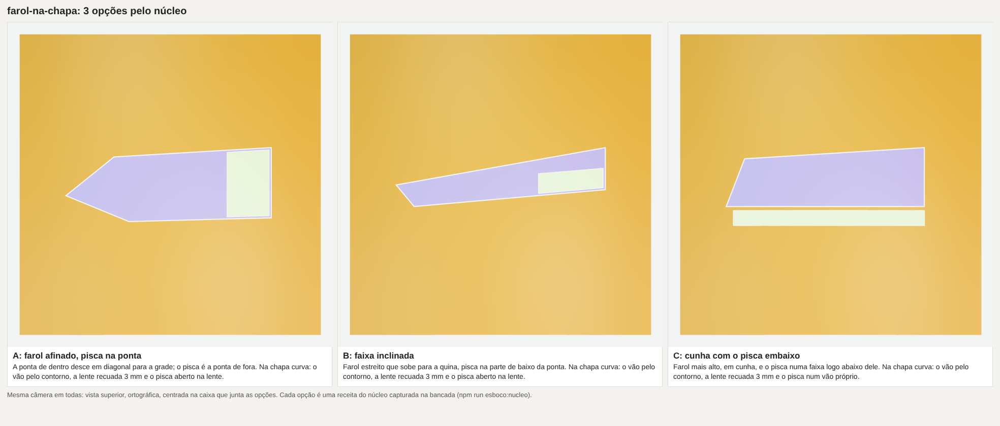
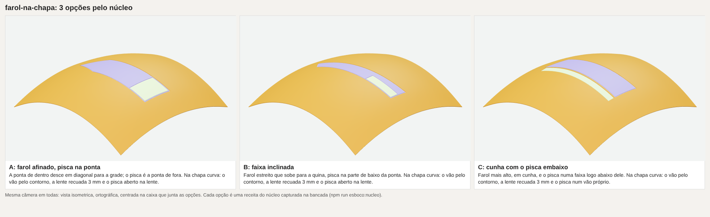
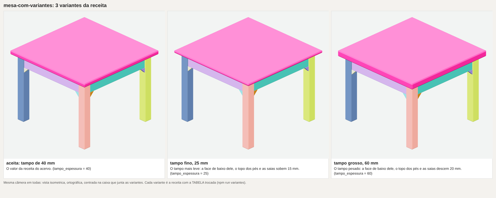

# Esboço pelo núcleo — inventário da fatia 1 e provas da fatia 2

Inventário do plano [esboço pelo núcleo](../../planos/2026-11-05-esboco-pelo-nucleo.md), em 2026-11-05, sobre a main em `c1933085`.
Ele responde quem usa o módulo `modulos/esboco/` hoje, quais recursos do esboço os arquivos guardados usam de fato, se alguma peça
aceita depende dele para reproduzir a forma, qual operação do núcleo faria cada tipo de forma e o que o esboço 2.0 precisa ter.
Nada fora desta pasta mudou. O módulo tem 117 arquivos de código com 32.125 linhas, das quais 15.054 em `src/` e `componentes/`, e um
README de 218 KB; ao redor dele, `tools/modelar/` tem 17 ferramentas `esboco-*.mjs` com 3.690 linhas e 14 testes `esboco-*.test.mjs`.

## Como reproduzir

As contagens saem de [`contar.mjs`](contar.mjs), que lê só arquivos versionados (`git ls-files`), não escreve nada e dá a mesma saída
para a mesma árvore. O grafo de import junta import estático, `export ... from` e `import('literal')` com caminho relativo.

```bash
node docs/modelar/banco-de-provas/esboco-pelo-nucleo-2026-11-05/contar.mjs usuarios    # item 1
node docs/modelar/banco-de-provas/esboco-pelo-nucleo-2026-11-05/contar.mjs recursos    # item 2
node docs/modelar/banco-de-provas/esboco-pelo-nucleo-2026-11-05/contar.mjs receitas    # item 3
node docs/modelar/banco-de-provas/esboco-pelo-nucleo-2026-11-05/contar.mjs tudo --json # tudo, em JSON
git log --diff-filter=A --format=%cs --name-only -- '*.esboco.json'                   # quando cada esboço entrou
npm run capacidade                                                                     # as gaiolas, para o item 4
```

## 1. Quem usa o módulo

Fora do módulo, 39 arquivos o importam direto: 21 ferramentas, 2 do pacote do crítico, 15 testes e 1 script de banco de provas.
Outros 62 chegam a ele por outro arquivo (18 ferramentas, 43 testes e 1 script de banco de provas), e 16 scripts do `package.json`
têm a entrada nesse fecho, seis deles gates de `npm run gates`: `guarda:acervo`, `guarda:referencial`, `guarda:tempo`,
`origens:check`, `calibracao:check` e `desenho:check`. Nenhuma receita, família ou arquivo do núcleo procedural está no fecho de
import, a não ser cinco testes. Os arquivos de fora usam 26 dos arquivos do módulo, e os mais importados são `src/index.js` (17 importadores),
`src/expandir.js` (11), `src/formas-resolvidas.js` (9), `src/desenho-da-blocagem.js` (9), `src/condutor.js` (8), `src/descrever.js`
(7), `src/plano.js` (7) e `src/referencia.js` (5). Todo arquivo do módulo passa por `src/index.js` (3.432 linhas), e por isso importar
qualquer pedaço carrega o desenhista inteiro.

As ferramentas se dividem em três papéis. O esboço propriamente dito é `tools/modelar/esboco.mjs` (17 arquivos do módulo) com
`esboco-blocagem*.mjs`, `esboco-brief.mjs`, `esboco-nivel-zero.mjs`, `esboco-referencia.mjs`, `esboco-familias.mjs`, a ajuda e a
recusa, e sai junto com o módulo. A ponte do esboço à receita é `receita-planejada.mjs` (expande, resolve e mede o contato para
escrever `TABELA`, `PONTOS`, `REFINA` e o alvo), `esboco-solido.mjs` com `forma-do-esboco.mjs` (as formas resolvidas e a malha de
família para a conferência de volume), `esboco-para-andaime.mjs` (o andaime do nível zero), `esboco-para-passos.mjs` (caixa,
chanfro, cilindro e extrusão em `PASSOS`, usado por `vistas-de-passos.mjs`, `vistas-da-receita.mjs` e `folha-comparativa.mjs`) e
`familia-com-esboco.mjs` (a família contra o componente de mesmo nome). As ferramentas gerais que usam um pedaço do módulo são as que
travam a remoção: `contorno-da-peca.mjs` importa o comparador de contornos `src/referencia.js`, e por ele `descrever-peca.mjs`, as
guardas do acervo, o retrato do acervo e o servidor MCP carregam o módulo; o pacote do crítico (`vistas-para-critica.mjs`) usa
`src/lados.js` para dizer de onde cada vista olha, em toda peça, mais `src/plano.js` e `src/referencia.js`, e
`sobreposicao-de-cortes.mjs` usa `src/plano.js`; `calibracao-do-critico.mjs` desenha as doze imagens do conjunto de calibração pelo
desenhista da blocagem, duas delas de fonte esboço e dez de família; `medida-do-desenho*.mjs` é o gate do desenho de linhas do
próprio módulo; `comecar.mjs` lista os componentes no roteiro; `receita-externa.mjs` usa `angulosDaMatriz` de `src/giro.js`; e
`cadeiras-medida.mjs` usa `descreverEsboco`.

Fora do código, 37 arquivos citam `npm run esboco`: 9 arquivos das skills `esbocar-opcoes`, `esboco-detalhado` e `laco-do-esboco`,
o agente `esbocista`, 15 documentos (README da raiz, mapa, roteiros, `PARE-E-ANALISE.md`, contratos e relatos de rodadas
encerradas), 6 ferramentas, o pacote do crítico, `procedural/pecas/aviao/ALINHAMENTO.md` e 4 testes. Nas skills e no agente, os modos
pedidos são `--condutor` (6 vezes), `--ajuda` (3), `--unidade` (2) e uma vez cada `--analise`, `--composta`, `--referencia`,
`--medidas-da-referencia`, `--medidas`, `--ligacoes`, `--veredito`, `--liberar`, `--forma`, `--vista` e `--imagem`. No código, 60
arquivos citam um `.esboco.json`, e 30 deles são receitas, todas do avião (8 `receita.js` e 22 rodadas), pelo caminho do
`REFINA.esboco`. As famílias `roda-pneu` e `dobradica` declaram o campo `esboco` do contrato (o componente e a conferência), que
`src/autoria/familia.js` valida e os testes delas conferem por `familia-com-esboco.mjs`, e o teste da família `cadeira` usa
`descreverEsboco`.

## 2. Os recursos usados nos esboços guardados

Há 86 `.esboco.json` versionados. Trinta são testes do módulo e três são fixtures de ferramenta, e ficam fora da conta de uso. Dos 53
de uso, 13 são opções de forma de peça (11 do braço, de 2026-09-28 e de 2026-11-03 e 04, e o farol e a lanterna do furgão, de
2026-11-05), 7 são receitas externas traduzidas por `receita-externa.mjs` (2026-10-19) e 33 são esboços detalhados do banco de provas
(rodadas de 2026-10-08 a 11, carrinho, empilhadeira, calibração e as duas rodadas do avião, a última de 2026-10-13). Depois de
2026-10-19 os únicos esboços novos são as 13 opções de forma, e nenhum esboço detalhado, Condutor ou gate de contato entrou depois do avião.

| recurso | opções de forma de peça (13) | receitas externas (7) | esboço detalhado (33) |
|---|---|---|---|
| opções, formas simples (visíveis) | 31, 220 (220) | 7, 199 (199) | 33, 1.052 (430) |
| tipos de forma | caixa 78, cilindro 67, anel 41, loft 17, extrusão 13, cone 4 | caixa 160, cilindro 31, extrusão 8 | caixa 427, loft 279, cilindro 180, extrusão 47, família 35, anel 31, tubo 24, revolução 20, cone 9 |
| posição (formas) | sobre 102, centro 70, desloca 49, ponta 48 | centro 199 | centro 553, de/para 144, rotação 117, desloca 86, ponta 41, sobre 15, encosta 14, alinha 12 |
| âncoras citadas, centro por âncora, por `entre` | 0, 0, 0 | 0, 0, 0 | 284, 184, 32 |
| componentes, espelhos, arranjos | 0, 0, 0 | 0, 0, 0 | 30 instâncias (roda 22, e 8 de módulos do próprio JSON), 53 espelhos, 11 lineares e 10 radiais |
| recorte (`subtrai`, cortadores) | 0 | 0 | 64 formas que subtraem, 85 cortadores, em 8 arquivos |
| gate de contato ligado, pares declarados | 0, 0 | 0, 0 | 31 arquivos, 17 pares |
| unidades, Condutor, detalhe de unidade | 0, 0, 0 | 0, 0, 0 | 18 arquivos com 144 unidades, 2 estados do Condutor versionados, 16 detalhes |
| `plano` | texto em 12 | nenhum | objeto em 33 (nível esquemático 17, médio 13, detalhado 2, sem nível 1) |
| raiz, outros | vista 13, legendas 2 | vista 7 | parâmetros 29, simétrico 20, pontos 16, curso 9, módulos 7, estilos 4 |

Os tipos `esfera` e `envolve` não aparecem em nenhum esboço, nem nos testes do módulo, e o arranjo por caminho também não. Nas
opções de forma de peça, que são o uso vivo, toda posição é `centro` por vetor, `sobre`, `ponta` ou `desloca`, sem rotação, âncora,
haste, componente, contato ou unidade; o farol do furgão são três opções de sete caixas e quatro extrusões cada, todas por `centro`
absoluto. A análise (`--analise`) não deixa rastro versionado, porque as imagens dela estão no `.gitignore`, e só se conta pelas
instruções que a pedem: a skill `esbocar-opcoes` e o `PARE-E-ANALISE.md`.

## 3. Peças aceitas que dependem do esboço

Nenhuma peça aceita depende do esboço para reproduzir a forma. Nenhuma receita está no fecho de import do módulo, as 8 receitas do
avião executam os `PASSOS` só com o núcleo, as famílias e as composições, e o `REFINA.andaime` delas aponta para
`procedural/pecas/aviao/andaime.json`, um arquivo guardado (objetivo `esboco-nivel-zero`) que `src/autoria/refinamento-global.js` lê
sem o módulo. A forma das peças, e com ela o retrato do acervo, não muda se o módulo sair.

O que quebra é a conferência. Sete partes do avião (asas, empenagem horizontal, empenagem vertical, hélice, motor, trem do nariz e
trens principais; a fuselagem não) declaram `REFINA.esboco` com `docs/modelar/banco-de-provas/aviao-2026-10-11/esboco-r2/aviao.esboco.json`,
opção 1 e mínimo de 0,95: o veredito de `descrever-peca` mede cada parte contra o sólido da forma do esboço pela razão
interseção/união de volume, e o sólido sai de `formasResolvidas` e de `malhaDaFamilia` do módulo, por `esboco-solido.mjs`. Sem o
módulo, o veredito dessas sete partes e a `guarda:acervo` falham. O alvo do pacote do crítico dessas mesmas sete é a composta da
unidade do esboço, gerada na hora por `npm run esboco -- --composta` e nunca guardada, e também falha. Duas dependências valem para o
acervo inteiro: `descrever-peca` importa `contorno-da-peca.mjs`, que importa `src/referencia.js` e por ele o módulo todo, de modo
que sem o módulo nenhum veredito carrega, e o braço robótico tem 3 `*.contornos.json` que esse comparador mede; e o pacote do crítico
de toda peça escreve o lado de cada vista por `src/lados.js`. Fora das peças, o gate `calibracao:check` depende do desenhista da
blocagem para as doze imagens gravadas (duas de fonte esboço), o `desenho:check` é o gate do próprio desenhista, e os testes de
`roda-pneu` e `dobradica` conferem a família contra o componente do esboço.

## 4. A operação do núcleo para cada tipo usado

As contagens são as dos 53 esboços de uso. As ferramentas `esboco-para-passos.mjs` (caixa, chanfro, cilindro e extrusão em
`PASSOS`, conferidos forma a forma) e `src/autoria/solido-do-esboco.js` com `tradutor-nivel-zero.js` (todo tipo menos a faixa como
sólido, e no andaime sem o furo da caixa e a rotação em dois eixos) já fazem parte da tradução, e os dois últimos não importam o módulo: recebem as formas resolvidas como dado.

| tipo e variante (formas) | operação do núcleo | observação |
|---|---|---|
| caixa simples (248) | `cubo` | o cubo apoia em y = 0; o tradutor centra pelo `em` |
| caixa com raio de canto (334) | `extrusao` de `{retangulo: {cantos}}` | o mesmo contorno do tradutor do nível zero |
| caixa com chanfro (83) | `chamferBox` | já convertida e conferida por `esboco-para-passos` |
| caixa com furos (0) | `extrusao` com `furos` | sem uso |
| cilindro (277), achatado (1) | `cilindro`; o achatado por `extrusao` do círculo cortado | |
| anel (72) | `extrusao` de `{circulo}` com furo `{circulo}`, ou `lathe` de quatro pontos | |
| cone em tronco (13), em ponta (0) | `lathe` de quatro pontos; `cone` só faz a ponta | o `cone` do núcleo não tem raio de topo |
| esfera (0) | `esfera` | sem uso |
| extrusão convexa (51), côncava (15), por expressão (2) | `extrusao` | a côncava se confere na fatia 2 |
| revolução reta (11), suave (9) | `lathe`; a suave por pontos amostrados da curva | a concordância do `lathe` é raio, e não a curva PCHIP do esboço |
| loft (296): centro deslocado 266, suave 79, casca 22, inclinação 3, reto 13 | `loft` com `pos` 3D e `contorno`; a casca por `subtrair` do loft recuado; a suave por mais seções amostradas | o `loft` do núcleo sai aberto sem seção de raio 0 nas pontas, e a tampa plana se mede na fatia 2; a seção inclinada não tem equivalente direto |
| tubo (24): com raio de curva 21, cantos em esfera 3 | `friso` de perfil `{circulo}` numa polilinha com os arcos amostrados | só no banco de provas |
| família (35): superfície aerodinâmica 30, roda e pneu 5 | `chamar` pelo registro de composições | é o que o provedor `esboco-familias.mjs` já faz |
| faixa `envolve` (0) | nenhuma | sem uso |
| recorte (64), espelho (53), arranjo linear (11) e radial (10) | `subtrair`, `espelha`, `arranja` | o arranjo por caminho (0) não tem equivalente |
| `centro`, `desloca`, `rotacao` | `em`, `transladar`, `rotaciona` | a rotação em dois ou três eixos (3) já sai em até três `rotaciona` |
| `sobre`, `ponta`, `alinha` | a caixa da malha que o núcleo gerou, medida antes de posicionar | medir a malha do núcleo, e não o prisma do esboço, é o que dá a forma que a peça daria |
| `encosta` | `encostar` | |
| `de`/`para` (144) | `poseQueEncaixa` de `src/autoria/posicao-por-porta.js` | só no banco de provas |

Nenhum tipo do esboço corresponde às gaiolas (`gaiolaPorEstacoes`, `gaiolaPorRede`, `gaiolaVarrida`, `gaiolaInterpolada`,
`gaiolaAneis`) nem ao sólido por laços. Elas são o que a peça usa e o esboço não sabe dizer, e foi por isso que as opções do farol,
desenhadas como caixas e extrusões, prometeram o bico e o topo reto que o vão na gaiola subdividida não entrega. O loft suave e o
sólido por laços descrevem o mesmo corpo por seções, mas a subdivisão aproxima os pontos em vez de passar por eles, e só com
`compensar` a superfície passa pela seção; por isso o 2.0 não troca um pelo outro, e a escolha de forma numa peça de gaiola vai pela
variante da receita. Sem equivalente ficam a seção inclinada do loft (3 formas, todas no avião), a faixa `envolve` e o arranjo por
caminho (0 usos), e se medem na fatia 2 a tampa plana do loft e a extrusão côncava.

## 5. O que o esboço 2.0 precisa ter

O mínimo que cobre o uso vivo é o subconjunto das 13 opções de forma de peça, lido do mesmo JSON para que os arquivos guardados
rodem sem reescrita: a raiz com `opcoes` (`titulo`, `nota`, `formas`), `vista` e `plano` em texto, ignorado como hoje; os tipos caixa
(com raio e chanfro), cilindro (com o achatado), anel, cone em tronco, extrusão e loft (seções retângulo, elipse, arredondado e
polígono, com centro deslocado e a suave por amostragem); e a posição por `centro` em vetor, `sobre`, `ponta` e `desloca`. A isso
convém somar, por custo baixo e uso no banco de provas, a `rotacao` (117 formas), a revolução (20), o recorte por `subtrai` (64), o
espelho (53) e os `parametros` com expressão pelo `criarResolverNumerico` do núcleo, que é como uma opção vira variante de outra sem
repetir as formas. A saída é uma receita em memória por opção, com `PASSOS` do núcleo, executada pelo executor e capturada na
bancada com a mesma câmera, numa imagem lado a lado com o título e a nota de cada opção. O que o núcleo não faz é recusado com o
motivo, e não desenhado de outro jeito, e cada forma é conferida pela caixa da malha contra a medida declarada, como
`esboco-para-passos` faz hoje.

Fica de fora o que só o banco de provas usou e não entrou desde 2026-10-13: o Condutor com estágios, unidades, Envelope, detalhar,
integrar e veredito; o gate de contato com pares, juntas e portas; os componentes e os módulos com `ligar` e `encaixa` (a roda,
que é 22 das 30 instâncias, já é a família `roda-pneu`); as âncoras nomeadas, o `entre` e a haste `de`/`para`; o tubo, a faixa e o
arranjo por caminho; a forma de família dentro do esboço, que numa receita é `chamar`; o curso do mecanismo, os estilos, a
simetria implícita e os materiais; o desenhista de linhas em SVG, as legendas numeradas, a análise de oito imagens, o corte, a
explosão, o zoom e a prévia; e o `--descrever`, o `--editar` e o `--referencia` do esboço.

A remoção do módulo pede, além da migração das skills, do agente e do alvo do crítico que a fatia 3 já tem, que alguns pedaços
gerais saiam dele antes: o comparador de contornos (`src/referencia.js`, 437 linhas, com o que ele usa de `projecao.js`) para junto
de `contorno-da-peca.mjs`, porque todo veredito o carrega e o braço o mede; o texto do lado de cada vista (`src/lados.js`, 107
linhas) e o `lerPlano` da orientação para o pacote do crítico; e o provedor da malha de família (`src/familia.js`, 84 linhas) para
`src/autoria`. As sete partes do avião com `REFINA.esboco` precisam de uma decisão da pessoa: a recomendação é gravar uma vez as
formas resolvidas da opção 1 (`mecanifica.formas-resolvidas@1`, o dado que `src/autoria/forma-do-esboco.js` já recebe) ao lado do
`andaime.json` e apontar o `REFINA.esboco` para elas, com a composta guardada como alvo, o que mantém a conferência de volume sem o
módulo; a outra saída é tirar a conferência e ficar só com o envelope do andaime. Também ficam para decidir o conjunto de
calibração do crítico, que se gera de novo pelas capturas da bancada ou guarda as imagens de hoje sem o desenhista, o gate
`desenho:check`, que sai com o desenhista, o campo `esboco` das famílias `roda-pneu` e `dobradica`, e o tradutor de receitas
externas, cujo destino é o esboço. Nenhum desses arquivos está no território do plano, e `vistas-para-critica.mjs` está no do braço.

## 6. Fatia 2: o esboço 2.0, as variantes e os gates 1 e 2

A fatia 2 entregou o módulo [`modulos/esboco-nucleo/`](../../../../modulos/esboco-nucleo/README.md), com `npm run esboco:nucleo -- <arquivo>`
(`tools/modelar/esboco-nucleo.mjs`) e `npm run variantes -- <peça>` (`tools/modelar/variantes.mjs`), os dois com `--ajuda`. Cada opção é
uma receita do núcleo em memória, com passos crus (todo o catálogo, as gaiolas, `gaiolaPorLacos`, `aberturaPorContorno` e as famílias
por `chamar`) e o atalho de formas posicionadas por `centro`, `sobre`, `ponta`, `desloca` e `rotacao`, resolvido pela caixa da malha
que o núcleo gerou. A captura é a da bancada: cada opção abre numa página com a sessão dela, e a câmera é uma só, ortográfica e
centrada na caixa que junta as malhas de todas as opções, convertida para o estúdio de cada página pela transformação que a bancada
deu à peça. A página devolve onde o centro e o quadro dos oito cantos da caixa comum caíram na tela, e nas quatro imagens desta
pasta a diferença entre as opções é zero até a quinta casa.

```bash
npm run esboco:nucleo -- docs/modelar/banco-de-provas/esboco-pelo-nucleo-2026-11-05/farol-na-chapa.esboco.mjs --saida <png>
npm run esboco:nucleo -- docs/modelar/banco-de-provas/esboco-pelo-nucleo-2026-11-05/farol-na-chapa.esboco.mjs --vista isometrica --saida <png>
node docs/modelar/banco-de-provas/esboco-pelo-nucleo-2026-11-05/medir-farol.mjs [--json]
npm run variantes -- docs/modelar/banco-de-provas/esboco-pelo-nucleo-2026-11-05/mesa-com-variantes.js --saida <png>
npx vitest run modulos/esboco-nucleo/
```

O leitor dos esboços antigos abre as 13 opções de forma de peça guardadas (11 do braço, o farol e a lanterna do furgão) sem
reescrita e sem recusa, e a malha de cada uma das 220 formas confere com a medida declarada a 0,5 mm mais a flecha do círculo. Dos 86
`.esboco.json` versionados, 21 abrem: as 13 opções de forma, as 7 receitas externas traduzidas e um teste do módulo antigo
(`modulos/esboco/tests/fixtures/teste-cubo.esboco.json`). Os 65 recusados são os 33
esboços detalhados do banco de provas, 29 dos 30 testes do módulo antigo e as 3 fixtures de ferramenta, todos com o motivo: campo da
raiz que o 2.0 não lê (`parametros`, `contato`, `pontos`, `simetrico`, `curso`, `estilos`, em 62 arquivos), unidade do Condutor
(33), haste por `de`/`para` (18), componente (17), tubo (14), espelho (13), `alinha` (12), forma de família (11), expressão no lugar
de número (6), casca do loft (4), centro por âncora (4) e, um arquivo cada, a tampa do loft com a seção fora do eixo, `encosta` e o
recorte. Nenhum deles é opção de forma, e todos são do uso que a seção 5 deixou de fora.

O teste do leitor abre cada `.esboco.json` versionado e exige que abra ou traga o motivo, e que as 13 opções de forma abram com
todas as faces em parte; o dos seis tipos confere a caixa e o fechamento de cada tradução (o anel e o loft sem aresta de borda, a
face plana do cilindro achatado no lado pedido, a base do cone no início do eixo, o perfil da extrusão em cada vértice desenhado).
Duas lacunas do loft ficaram medidas: o loft do núcleo sai aberto sem polo, e o leitor o tampa com um polo a 0,01 mm da seção da
ponta, uma tampa plana a menos de 0,01 mm; e o polo fica na reta do eixo, porque um polo fora dela inclina as seções das pontas
(medido no ombro com cantos `[32, 32, 2, 2]`, cuja malha saía com 364 mm em vez de 210 antes da correção). A extrusão côncava passa
(o farol A tem perfil côncavo e confere vértice a vértice).

### Gate 1: as opções do farol numa chapa curva

[`farol-na-chapa.esboco.mjs`](farol-na-chapa.esboco.mjs) é um esboço do 2.0 em módulo: lê o farol e o pisca da direita das três
opções de `procedural/pecas/furgao-realista/referencias/farol-dianteiro.esboco.json` e os leva à chapa da abertura de prova
(`tools/fixtures/abertura-de-prova/chapa.js`, 800 por 800 mm, 2 mm, raio 600 mm em x e 900 mm em z), com a ponta de dentro do farol
em x 120 e o topo em z 300. O farol é um vão de `aberturaPorContorno` com a lente recuada 3 mm. O pisca de A e de B fica dentro do
conjunto e é um segundo vão aberto na lente do farol, com o contorno cortado pelo farol recuado 6 mm, porque o vão não pode encostar
na borda do sólido que corta; o de C fica 8 mm abaixo do farol e é um segundo vão na chapa. As três receitas executam sem recusa,
com todas as faces em parte (`chapa`, `farol` e `pisca`).





[`medir-farol.mjs`](medir-farol.mjs) mede cada vão contra o contorno desenhado. A borda de fora do farol, achada nas arestas da chapa
por `bordaDoVao`, fica a 0,000 mm do desenho nas três opções, nos dois sentidos, e cada canto tem na malha o ângulo do desenho a
menos de 0,01 grau: o bico de A tem 61,31 graus e o de B 60,32, os dois iguais aos desenhados, e o topo de cada farol é a reta do
desenho. O pisca, medido pela borda que a operação registra (o caminho de `bordaDoVao` não fecha na lente, e a causa não foi
investigada), fica a 0,003 mm do desenho em A e a 0,000 em B e C, com a maior diferença de ângulo de 0,02 grau (A). É a forma que a
peça daria, porque é a mesma receita que a bancada executou: o hash do neutroCanonico é `78248fa1cd409ad4` (A, 2.634 faces),
`098c3b2fc9573244` (B, 2.553) e `a712ed3365ebfce7` (C, 2.680). O que o esboço antigo prometeu e a gaiola subdividida não entregou, o
bico e o topo numa linha só, o vão por contorno entrega; a escolha da pessoa entre as três continua sendo pela imagem.

### Gate 2: a mesa com três variantes

[`mesa-com-variantes.js`](mesa-com-variantes.js) é a cópia de prova de `procedural/pecas/mesa-quadrada-escura/receita.js`, o mesmo
código com um parágrafo no cabeçalho e `VARIANTES` no fim: o tampo de 40 mm (o aceito), de 25 mm e de 60 mm. A receita do acervo não
mudou. A variante aceita dá o neutroCanonico `fffabfa1c97c3332…`, o mesmo da receita do acervo e da cópia sem troca, e as outras duas
dão `4b40277eb58d16be…` e `39758461aee95348…`, com as mesmas 274 faces e a mesma caixa externa; o teste
`modulos/esboco-nucleo/tests/variantes.test.js` confere a igualdade pelo hash inteiro e que a tabela do acervo continua com 40 mm
depois das variantes.


