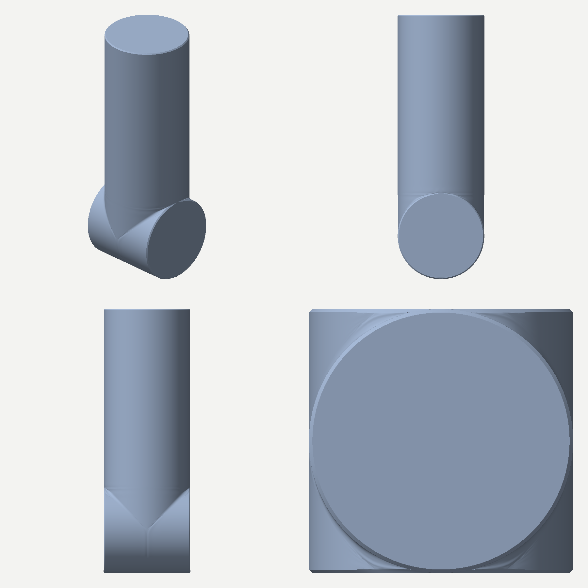

# Limites do sólido por laços — provas das fatias 1 a 3

Provas do plano [limites do sólido por laços](../../planos/2026-11-05-limites-do-solido-por-lacos.md), em 2026-11-05. A peça de teste é a
coluna sobre disco, em `tools/fixtures/solido-por-lacos/coluna.js` (a forma e os laços em `coluna-forma.js`, as medidas em
`coluna-medir.mjs`, o teste em `coluna.test.ts`, o alvo em `referencias/alvo-da-coluna.md`): um disco de eixo z (raio 78 mm, espessura
156 mm) e um cilindro de 156 mm de diâmetro e eixo y que sobe dele, tangente às duas faces, com o topo plano a 477 mm do fundo do disco,
chanfro de 2 mm na borda do disco e no topo, e filete de raio nominal 12 mm no encontro. Ela não cita o braço. Os laços são os planos
y = constante, cortados ao longo do eixo do cilindro, 32 planos de 96 pontos em dezoito trechos, e as medidas abaixo são da malha de
24.810 vértices e 24.808 faces que o passo `subdivisao` entrega em dois níveis. O ajudante de antes é o de `8ccbf140`
(`git show 8ccbf140:procedural/nucleo/gaiola-por-lacos.js`); "antes" é a mesma peça passada por ele, com o mínimo entre planos
afrouxado para 1,5 mm só para a gaiola sair, e "depois" é o ajudante de agora.

## Os cinco limites, como cada um apareceu

A peça foi escrita do jeito natural: o contorno no plano y, os chanfros do disco com `entre` em todos os laços, o topo com vinco de laço
inteiro, `compensar` nas curvas, o fundo do disco em y = -78 mm e o topo em y = 399 mm. Quatro dos cinco limites apareceram assim, e o
quinto apareceu de outro modo que o da coluna do braço; os testes de cada um estão em `gaiola-por-lacos.test.ts` (peça pequena) e em
`coluna.test.ts` (a mesma peça com a declaração retirada).

Limite 3, a distância mínima entre planos contra o chanfro de 2 mm, foi o primeiro e o que reproduziu exatamente: os planos y = 397 e
y = 399 mm do chanfro do topo ficam a 2 mm, e o ajudante de antes recusou a gaiola ("ficam a 2 mm um do outro, abaixo do mínimo de 2,5
mm"). Na coluna do braço a solução foi levar o chanfro a 2,6 mm. O que o mínimo evita é a ondulação da faixa estreita entre planos
lisos; entre dois vincos vivos de laço inteiro a faixa é isolada, e o ajudante de agora aceita planos mais perto que o mínimo quando os
dois levam `{ laco, nitidez: 'viva' }`, sem `trechos`, e cala o aviso de planos desiguais em torno deles. O chanfro do topo sai com
2,002 mm de raio e 2,000 mm de altura.

Limite 1, a tampa com quadrilátero de área zero, e limite 2, a parede no plano da tampa, saíram no mesmo lugar: o fundo do disco. O
disco é tangente ao plano y = -78 mm, e o laço ali é uma linha de 152 mm (z de 2 a 154), com a parede de subida do lado D sobre a de
descida do lado E. O ajudante de antes aceitou o laço e tampou a linha com a escada, que liga o ponto j de uma cadeia ao ponto j da
outra, e saíram 10 faces de área zero na gaiola. Na coluna do braço o laço era em cruz (o registro do backlog diz eixo X, e cortado em x
o disco e a coluna se cruzam no plano da ponta), e a cruz não apareceu aqui, porque cortada em y a seção da coluna não tem cruz na ponta
(tem um círculo no topo e uma linha no fundo). Reproduzi a cruz em `gaiola-por-lacos.test.ts` com um prisma de seção em cruz, com
espessura zero na ponta (duas linhas que se cruzam, que o ajudante de agora funde) e com espessura (que ele recusa com a medida).

Limite 4, o trecho que some e volta entre planos, e o passo dentro do trecho, apareceram no filete e na parede do disco. O filete tem
comprimento zero em y = 0 e em y = 78 mm, e fica pequeno nos planos vizinhos: sem tratamento, a gaiola teve 40 faces finas (área sobre o
quadrado da maior aresta abaixo de 0,005, a pior 0,0008) e 8 avisos de amostragem desigual, de razão até 189 (a parede de 76 mm de
comprimento em seis pontos junto de um filete de 0,7 mm). O trecho que some e volta mesmo (some, volta, some) não ocorre na coluna cortada
em y, onde o filete aparece em y = 0 e acaba em y = 78 mm sem voltar; ele ocorria na coluna do braço, cortada em z, e está testado em
peça pequena. A correção são dois campos do trecho, `razao` (o último segmento sobre o primeiro, em progressão geométrica) e `some` (o
comprimento em mm abaixo do qual o trecho vira um ponto no laço), mais o aviso `facesFinas`.

Limite 5, a compensação junto da tampa empurrando a peça para fora, apareceu como o contrário do relato: o ponto da borda do chanfro, que
é uma curva de vinco vivo, andava pela normal média das faces vizinhas, que inclui a da face plana, e o anel do chanfro ficava para
dentro. Passada a mesma gaiola com a compensação de antes, o chanfro do disco saía com 2,409 mm de raio (a borda da face 0,39 mm para
dentro) e o do topo com 3,212 mm (a borda do topo 1,13 mm para dentro). Com a regra de agora, em que o ponto em dois vincos vivos anda só
pela parte perpendicular à curva do vinco, os dois saem com 2,001 e 2,002 mm. Na coluna do braço o mesmo erro saiu para fora (0,3 mm), e numa
rodada anterior desta peça, com o ajudante de antes e sem vincos no chanfro, a face saiu 0,51 mm além do plano, contra 0,20 mm agora.

## Antes e depois

| medida | antes | depois |
|---|---:|---:|
| planos a 2 mm (chanfro do topo) | recusa | aceita, com vinco vivo nos dois |
| faces da gaiola de área zero | 10 | 0 |
| faces da gaiola finas (< 0,005), a pior | 40, 0,0008 | 0, 0,0061 |
| avisos de amostragem desigual, razão máxima | 8, 189,2 | 0 |
| aviso de planos desiguais | 1 | 0 |
| pontos e faces da gaiola | 1.636 e 1.702 | 1.519 e 1.584 |
| chanfro do topo, radial e axial, declarado 2 mm (compensação de antes) | 3,212 e 2,016 | 2,002 e 2,000 |
| chanfro da borda do disco em y = -30, radial e axial, declarado 2 mm (idem) | 2,409 e 1,977 | 2,001 e 2,000 |

O "antes" da compensação é o ajudante de agora sem a regra do ponto em dois vincos vivos (o de antes não tem a faixa de laços do vinco,
que a peça precisa para o chanfro do disco acabar onde o disco acaba). As quatro primeiras linhas são o ajudante de `8ccbf140`.

## A peça de teste, medida (gate 2)

| medida | declarado | malha |
|---|---:|---:|
| arestas sem par, vínculos não manifold, triângulos sem área | 0, 0, 0 | 0, 0, 0 |
| achados de reprova do `analisarTopologia` (com triangulação) | nenhum | nenhum |
| menor área sobre o quadrado da maior aresta, na malha final | acima de 0,003 | 0,0136 |
| chanfro do disco em y = -50, -30 e -10, radial | 2 mm | 1,998, 2,001, 2,001 |
| chanfro do disco nos mesmos cortes, axial | 2 mm | 1,980, 2,000, 2,000 |
| chanfro do topo, radial, axial; altura do topo | 2 mm, 2 mm; 399 mm | 2,002, 2,000; 399,000 |
| raio do cilindro em y = 120, 250, 380, 396 | 78 mm | 77,95 a 78,08 |
| raio do disco em z = 20, 78, 130 | 78 mm | 77,62 a 78,08 |
| extensão em x, y e z | ±78, -78 a 399, 0 a 156 | ±78,136, -78,132 a 399,000, -0,203 a 156,203 |

O fundo do disco chega a 78,132 mm abaixo do eixo porque a compensação, com `pontas: true`, move também os pontos da lâmina do fundo
ao longo do eixo; sem isso o fundo ficava 0,8 mm acima (raio 77,22 mm na volta de baixo). O encontro, medido como o recuo da superfície
em relação à quina viva da parede do disco com o cilindro, no corte de cada plano, contra o recuo de um filete de raio nominal 12 mm
com a dobra do plano:

| plano y (mm) | dobra no plano | recuo medido | recuo declarado | diferença |
|---:|---:|---:|---:|---:|
| 13,5 | 10,0° | 0,122 | 0,046 | 0,076 |
| 26,7 | 20,0° | 0,212 | 0,185 | 0,027 |
| 39,0 | 30,0° | 0,475 | 0,423 | 0,052 |
| 50,1 | 40,0° | 0,832 | 0,769 | 0,063 |
| 59,8 | 50,1° | 1,306 | 1,244 | 0,062 |
| 67,5 | 59,9° | 1,858 | 1,851 | 0,007 |

Os filetes de y = 72,9 e 75,5 mm, perto da tangente, ficam limitados pela parede de 2 mm de chanfro e não se medem. A ondulação lida pela
ferramenta `ondulacao` (não é gate desta peça) acusa 102 falhas, a maior de 0,47 mm: seis calombos para dentro de 0,36 a 0,47 mm na
parede do cilindro e nos filetes, quatro para fora de 0,43 mm na parede do disco junto de y = 10 mm, e 92 emendas de 0,05 a 0,32 mm entre
y = 2 e 26 mm. Nenhuma face fica virada.

## As duas partes pelos grupos da gaiola

O passo `subdivisao` ganhou o campo `grupos`, uma lista de `{ nome, pontos }` em nomes de ponto da gaiola. As faces do grupo são as da
gaiola com todos os pontos nele, e as faces refinadas que descendem delas (em qualquer nível) saem como `parte` da origem do passo:
`parte` cita `{ origem: { op: 'subdivisao', id, parte: 'pe' } }` e recorta a superfície pela gaiola. A gaiola devolve os grupos prontos
(`grupos: [{ nome, lacos: [de, ate], trechos } | { nome, unir: [...] }]`, em `passo.grupos`). Na coluna, `pe` são os trechos do disco
(as faces, os chanfros, a parede e os filetes) e `coluna` é a parede do cilindro e a tampa do topo: 10.576 e 14.232 faces, as duas somam
as 24.808. A parede do cilindro entre o eixo do disco e o topo dele (x = 77,5 mm, y = 40 mm, z = 78 mm) fica em `coluna`, e a face de
baixo do disco fica em `pe`; na coluna do braço, a região recortava por caixa e deixava essa parede no pé. O grupo só vale sem espessura
e sem simetria, e o nome não pode ser `externa`, `interna` nem `borda`. O contrato da origem `subdivisao`, que mora em `nucleo.js`, passou a
aceitar o nome de um grupo em `parte`.

## O L e a dobra em U saem iguais

A impressão da malha (sha1 dos vértices em metro a 6 casas e das faces com a parte) é a mesma antes e depois: `36b4d573a66c` no L
(13.034 vértices, 13.032 faces) e `6467eb2f5077` na dobra em U (7.874 e 7.872), e o teste `solido-por-lacos.test.ts` agora a confere.
As compensações das variantes dão o mesmo canto (31,807 mm) e as mesmas curvas (40,068 e 24,040 mm); a gaiola passou a mover 234 pontos
da dobra em vez de 216 (pontos em dois vincos vivos que a regra de antes não movia), com o mesmo maior deslocamento (1,179 mm). Uma conta de ponto flutuante na reamostragem (`total * (i / (n - 1))` no lugar de `(total * i) / (n - 1)`) mudou
a malha da dobra em um dígito distante, e a expressão voltou à de antes quando o passo é igual.

## O que ficou como recusa

A tampa em cruz com espessura, em que os degraus da escada caem sobre a mesma reta, fica como recusa com a medida ("a tampa do laço 'l0'
tem 2 faces de área zero, a primeira com os pontos ..."). Cobri-la pede triangular um polígono côncavo dentro de uma gaiola de
quadriláteros, e o passo que ela alimenta só aceita faces simples; o que fazer é cortar por outro eixo, em que o primeiro e o último
laço sejam convexos, ou deixar a ponta com área zero, que o ajudante funde. O limite do trecho que some e volta é tratado por declaração
(`some`), que muda a forma até metade do valor declarado no laço onde o trecho some, e não por ajuste automático, porque o ajudante não
sabe o que é filete e o que é aresta curta de verdade.

## As imagens

As quatro vistas da peça (isométrica, frontal, direita e superior, na folha `coluna-quatro-vistas.png`, nessa ordem, da esquerda para a
direita e de cima para baixo) estão nesta pasta, uma por arquivo (`coluna-isometrica.png`, `coluna-frontal.png`, `coluna-direita.png`,
`coluna-superior.png`).



`npm run bancada -- tools/fixtures/solido-por-lacos/coluna.js --vistas=isometrica,frontal,direita,superior` aceita o caminho da receita,
mas precisa do navegador do Playwright, que não está instalado neste ambiente; as imagens saíram de
`tools/fixtures/solido-por-lacos/desenhar-vistas.mjs` (projeção ortográfica da malha do núcleo, z-buffer e sombra de Lambert), que
dispensa o navegador.

## Como reproduzir

```
npx vitest run procedural/nucleo/gaiola-por-lacos.test.ts procedural/nucleo/subdivisao-grupos.test.ts tools/fixtures/solido-por-lacos
node tools/fixtures/solido-por-lacos/desenhar-vistas.mjs docs/modelar/banco-de-provas/limites-do-solido-por-lacos-2026-11-05
npm run capacidade -- gaiolaPorLacos
```
