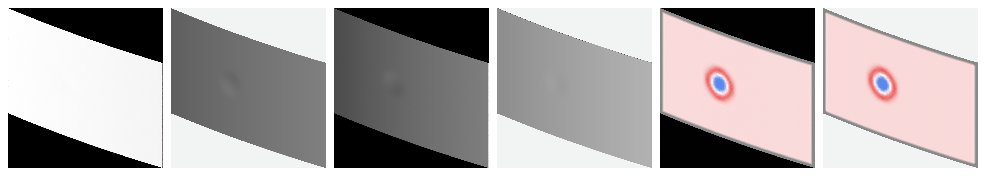

# Reflexo na bancada: a paridade da luz rasante e da curvatura com o Blender

Pasta do plano [reflexo na bancada](../../planos/2026-11-15-reflexo-na-bancada.md), fatias 5 e 6, medidas em 2026-11-16. A pergunta é se a luz rasante e a curvatura que a bancada captura por comando (`npm run bancada -- <peça> --visao=luz-rasante|curvatura`) dizem o mesmo que as do Blender 4.2.3 (`tools/modelar/vistas-de-superficie.mjs`), que o pacote do crítico de peça de lataria exigia até a fatia 6. A pessoa decidiu pela medida da fatia 5 deixar de exigir o Blender, e a fatia 6 mediu a vista de três quartos e fez a troca, na última seção.

## Como se mediu

O script [`medir-paridade.mjs`](medir-paridade.mjs) gera as vistas do Blender da peça e, para cada azimute que o Blender escolheu na vista, a luz rasante da bancada com o mesmo azimute, em projeção ortográfica e enquadrada, e a curvatura da bancada na mesma vista. Cada imagem é lida na caixa da peça nela (no Blender, o que não é o fundo preto da curvatura; na bancada, o que não é o fundo da auditoria), e as posições são dadas em fração dessa caixa, de 0 a 1 da esquerda para a direita e de cima para baixo. A fração iluminada segue a regra do Blender (luminância do PNG acima de 8/255 dentro da peça). A posição do amassado é o centroide do 1 % de pixels que mais mudam entre a chapa com amassado e a chapa lisa, na mesma ferramenta. A curvatura que a cor diz sai da cor do pixel, de volta ao linear, pela escala de cada ferramenta; a escala da bancada é a da conta dela (`calculo-da-curvatura.js`), a mesma que a página mostra na legenda. As duas curvaturas são comparadas numa grade de 60 por 40 pontos da caixa, onde as duas têm valor.

As duas peças foram a chapa de prova com amassado (`tools/fixtures/acervo/chapa-de-reflexo-de-prova`, 1000 por 600 mm, amassado de 1,2 mm de fundo e 80 mm de raio em x 400 e y 300, com a lisa como controle), na vista de frente, e o quarto traseiro do carro (`carro-fastback/lataria`, rodada 1), na vista de lado, de +x. Os números estão em [`paridade-chapa.json`](paridade-chapa.json) e [`paridade-quarto-traseiro.json`](paridade-quarto-traseiro.json), e cada um se refaz com:

```
MODELAR_BLENDER=<blender 4.2.3> node docs/modelar/banco-de-provas/reflexo-na-bancada-2026-11-15/medir-paridade.mjs chapa-de-reflexo-de-prova --vista-blender=frente --vista-bancada=frontal --rotulo=chapa --lisa=chapa-lisa-de-reflexo-de-prova --amassado=0.4,0.5 --figura=tmp/paridade-chapa.png
MODELAR_BLENDER=<blender 4.2.3> node docs/modelar/banco-de-provas/reflexo-na-bancada-2026-11-15/medir-paridade.mjs carro-fastback/lataria --vista-blender=lado --vista-bancada=direita --rotulo=quarto-traseiro --figura=tmp/paridade-quarto-traseiro.png
```

A chapa leva perto de 3 minutos e o quarto traseiro perto de 7, quase todo no Blender. As figuras desta pasta são as do `--figura`, reduzidas a JPEG.

## A chapa com amassado

Na figura, da esquerda para a direita: a luz rasante do Blender e a da bancada com a luz a 30 graus, as duas a 120 graus, e a curvatura do Blender e a da bancada.


| medida | Blender | bancada |
| --- | --- | --- |
| fração iluminada, luz a 30 graus | 1,000 | 1,000 |
| fração iluminada, luz a 120 graus | 1,000 | 1,000 |
| amassado na luz rasante a 30 graus (u, v) | 0,4000; 0,5000 | 0,3997; 0,5008 |
| amassado na luz rasante a 120 graus (u, v) | 0,4001; 0,5035 | 0,3992; 0,4995 |
| maior mudança de luminância no amassado, 30 e 120 graus | 0,0235 e 0,0275 | 0,0235 e 0,0275 |
| amassado na curvatura (u, v) | 0,3998; 0,4994 | 0,3996; 0,4994 |
| escala da cor da curvatura | 0,24703 1/m | 0,24758 1/m |
| curvatura que a cor diz no centro do amassado | −0,2465 1/m | −0,2475 1/m |

O amassado declarado fica em u 0,4 e v 0,5, e as duas ferramentas o põem a até 0,001 da caixa em u (1 mm) e a até 0,004 em v (2,4 mm). A luminância das duas luzes rasantes tem correlação de 0,999 e 0,998 na grade, com média de 0,482 contra 0,481 e de 0,485 contra 0,483. A curvatura das duas tem correlação de 0,997 e diferença mediana de 0,003 1/m, 1 % da escala; no centro do amassado as duas saturam a cor, e o valor dali diz só que as escalas batem.

## O quarto traseiro do carro

A mesma ordem: a luz rasante a 230 graus e a 320 graus, que o Blender escolheu para a vista de lado, e a curvatura.


| medida | Blender | bancada |
| --- | --- | --- |
| fração iluminada, luz a 230 graus | 0,909 | 0,908 |
| fração iluminada, luz a 320 graus | 0,785 | 0,805 |
| luminância média da peça, 230 e 320 graus | 0,638 e 0,501 | 0,533 e 0,447 |
| correlação da luminância na grade, 230 e 320 graus | 0,981 e 0,952 | |
| escala da cor da curvatura | 3,77573 1/m | 3,77574 1/m |
| correlação da curvatura na grade | 0,984 | |
| diferença da curvatura na grade, mediana e percentil 90 | 0,047 e 0,237 1/m | |

A carroceria não tem amassado declarado, e a posição de um defeito não se mede nela; o que se mede é que as duas imagens mostram as mesmas manchas no mesmo lugar, pela correlação. A bancada sai mais escura em média, 16 % a 230 graus e 11 % a 320, porque ela reduz a força da luz quando a peça passa de 0,7 de brilho no percentil 99 (`exposicaoDaLuz`, de `src/bancada/visoes/visao-luz-rasante.js`), e o Blender não reduz: na mesma figura, o painel de trás do Blender a 230 graus chega perto do branco e o da bancada não. A diferença da curvatura passa de 0,24 1/m, 6 % da escala, só num décimo dos pontos da grade; onde eles ficam não foi medido.

## O que não foi medido na fatia 5

A vista de três quartos não entrou na fatia 5: a do Blender olha de (0,55; 0,45; 0,70), e a isométrica da bancada olha de (1; 0,72; 1), de modo que as duas não eram a mesma imagem. Ela foi medida na fatia 6, na seção abaixo. Ficou fora a vista de cima, e só duas peças foram medidas.

## Recomendação

Deixar de exigir o Blender no pacote de lataria, trocando a luz rasante e a curvatura dele pelas da bancada, numa fatia própria que faça três coisas antes de tirar a exigência: o `vistas:critica` capturar a luz rasante e a curvatura pela bancada nas vistas de frente e de lado, com a fração iluminada medida em cada imagem e a recusa abaixo de 25 % que o Blender tem hoje; o `pacote.json` e o registro da rodada (`superficieDoPacote`) aceitarem essas imagens; e a vista de três quartos medida antes de entrar. A razão é que, nas duas peças, as duas ferramentas dizem o mesmo: a mesma fração iluminada a 2 pontos, o amassado no mesmo lugar a até 2,4 mm e com o mesmo contraste, a mesma escala de cor a 0,2 % e o mesmo mapa de curvatura, com correlação de 0,98 ou mais. A única diferença medida é o brilho mais baixo da bancada no carro, que é a correção de exposição dela e não muda onde as manchas estão. Enquanto essa fatia não vier, o pacote segue como está: a zebra e a pintura da bancada ao lado das vistas do Blender, que seguem exigidas.

## O crítico cego na chapa de prova (2026-11-16)

O pacote de `npm run vistas:critica -- chapa-de-reflexo-de-prova`, com o PLANO dizendo "chapa lisa" e sem citar o amassado, foi a um crítico visual sem contexto. Ele deu nota 5 e achou um defeito só: um afundamento circular de 100 a 180 mm, uns 100 mm à esquerda do centro em x e no meio em y, que é o amassado declarado (0,4 da largura e 0,5 da altura, 80 mm de raio). Ele o viu na curvatura (o achado mais claro), na zebra frontal (a listra escura partida por um disco de polaridade invertida), na pintura frontal (um disco pálido dentro da faixa escura) e na luz rasante de frente; nas vistas de Modelo, só como mancha muito sutil. O gate do pacote passa: a zebra e a pintura, sozinhas, já mostram o amassado.

Dois atritos saíram do veredito. A imagem de curvatura de lado veio com uns 76 px de largura, com o título e a legenda cortados, porque a chapa vista de quina é estreita (a regra de quina das visões novas não vale para as do Blender). E o vocabulário de `sentido` do veredito não tem termo para afundamento localizado num painel liso, e o crítico escolheu `segmentado` por falta de outro. Os dois foram ao backlog.

## A vista de três quartos e o pacote sem o Blender (fatia 6, 2026-11-16)

A bancada ganhou a vista `tresquartos` (`npm run bancada -- <peça> --vistas=tresquartos --enquadrar`), que gira a câmera da isométrica até olhar de (0,55; 0,45; 0,70), com +y para cima, como a do Blender. A afirmação da fatia 5 de que a do Blender mostra só a metade de x positivo vale para o pacote cego, que passa a simetria; as vistas de superfície não a passam, e as duas ferramentas mostram a peça inteira. A silhueta confere: a caixa da chapa na imagem tem proporção 0,968 no Blender e 0,967 na bancada, e a conta da caixa plana dá 0,966 para a direção do Blender e 0,827 para a isométrica. A medida é a do mesmo script, com `--vista-blender=tresquartos --vista-bancada=tresquartos`; o Blender roda só a vista medida, e `--luz-da-bancada` usa na bancada as duas direções que o pacote usa (a que ela escolhe pela vista e a outra boa a 90 graus dela) no lugar dos azimutes do Blender:

```
MODELAR_BLENDER=<blender 4.2.3> node docs/modelar/banco-de-provas/reflexo-na-bancada-2026-11-15/medir-paridade.mjs chapa-de-reflexo-de-prova --vista-blender=tresquartos --vista-bancada=tresquartos --rotulo=chapa-tresquartos --lisa=chapa-lisa-de-reflexo-de-prova [--luz-da-bancada]
MODELAR_BLENDER=<blender 4.2.3> node docs/modelar/banco-de-provas/reflexo-na-bancada-2026-11-15/medir-paridade.mjs carro-fastback/lataria --vista-blender=tresquartos --vista-bancada=tresquartos --rotulo=quarto-traseiro-tresquartos [--luz-da-bancada]
```

A chapa leva perto de 2 minutos e 40 segundos, e o quarto traseiro perto de 6. Os números estão nos quatro `paridade-*-tresquartos*.json` desta pasta.



| chapa com amassado, três quartos | Blender | bancada |
| --- | --- | --- |
| direções da luz (azimute e altura sobre o plano da imagem) | 30 e 120 graus, a 10 graus | 240 e 150 graus, a 50 graus |
| fração iluminada | 0,999 e 0,999 | 1,000 e 1,000 |
| amassado na luz rasante (u, v) | 0,3844; 0,4746 e 0,3840; 0,4756 | 0,3818; 0,4713 e 0,3820; 0,4739 |
| maior mudança de luminância no amassado | 0,0078 e 0,0353 | 0,0314 e 0,0196 |
| amassado na curvatura (u, v) | 0,3839; 0,4744 | 0,3839; 0,4741 |
| escala da cor da curvatura | 0,24703 1/m | 0,24758 1/m |
| curvatura na grade: correlação, diferença mediana e percentil 90 | 0,995; 0,003 e 0,005 1/m | |

A bancada sobe a luz a 50 graus nessa vista, porque a chapa se inclina 45 graus para longe do plano da imagem, e o Blender fica nos 10 graus. Por isso a luz rasante não se compara pela luminância, e sim pela fração iluminada e pela posição do amassado, que ficam a até 0,004 da caixa. Com os azimutes do Blender e a altura da bancada a medida mostrou o risco de misturar as duas: a 30 graus de azimute e 50 de altura a luz chega quase de frente à chapa, e a imagem da chapa amassada saiu igual à da lisa, pixel a pixel (`paridade-chapa-tresquartos.json`). É por isso que a segunda direção da bancada não é a do Blender: a visão de luz rasante escolhe, na mesma altura, a direção a 90 graus da primeira com a maior legibilidade (`segundaLuz`, em `src/bancada/visoes/azimute-da-luz.js`), e a publica na caixa da visão, de onde a captura a lê.


| quarto traseiro, três quartos | Blender | bancada |
| --- | --- | --- |
| fração iluminada com as direções do Blender (350 e 80 graus) | 0,327 e 0,347, a 10 graus | 0,900 e 0,686, a 60 graus |
| fração iluminada com as direções da bancada (10 e 280 graus) | | 0,929 e 0,975, a 60 graus |
| escala da cor da curvatura | 3,77573 1/m | 3,77574 1/m |
| curvatura na grade: correlação, diferença mediana e percentil 90 | 0,954; 0,047 e 0,197 1/m | |

No carro, a luz de 10 graus do Blender deixa dois terços da peça no escuro nessa vista, e as duas imagens dele mal passam do limiar de 25 %; a da bancada ilumina de 69 a 98 %. A curvatura tem a mesma escala, e a correlação de 0,954 é menor que a de 0,984 da vista de lado; a diferença passa de 0,2 1/m, 5 % da escala, só num décimo dos pontos da grade. A vista de três quartos entrou no pacote: a curvatura diz o mesmo que a do Blender, o amassado sai no mesmo lugar, e a luz da bancada alcança mais da peça que a do Blender.

O que mudou no pacote: `npm run vistas:critica` captura a luz rasante e a curvatura pela bancada nas vistas de frente, de lado, de cima e de três quartos, com a fração iluminada medida em cada PNG pela regra do Blender e a curvatura com a escala e a barra de cor escritas em cima da imagem; a vista em que a peça ocupa menos de 20 % do quadro num dos lados sai também destas, como já saía da zebra e da pintura, o que resolve o primeiro atrito do crítico cego (a curvatura de lado da chapa com 76 px de largura); a imagem abaixo de 25 % sai do pedido com a vista, o azimute, a altura da luz e a fração, e sem nenhuma acima o pacote é recusado; `MODELAR_BLENDER` deixou de ser exigido, e `--com-blender` roda as vistas do Blender como conferência, em `conferencia-do-blender/` da pasta da rodada, fora do pedido. O mesmo vale para `npm run vistas:superficie`. Na chapa de prova, sem `MODELAR_BLENDER`, o pacote levou 1 minuto e 54 segundos, contra 2 minutos e 48 com o Blender; o pedido lista 21 imagens, todas existentes, contra 27 antes, e as 6 a menos são a luz rasante e a curvatura de lado e de cima, de quina. O pedido não cita o amassado da chapa; a palavra aparece só na frase geral da seção de superfície ("o amassado largo e raso"), a mesma que o pedido do crítico cego já tinha.
