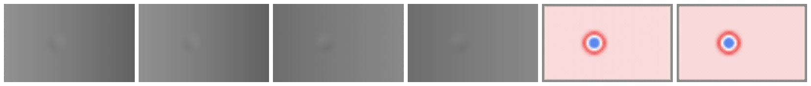
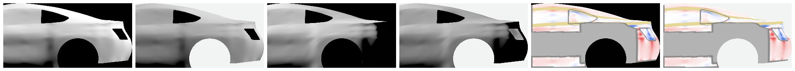
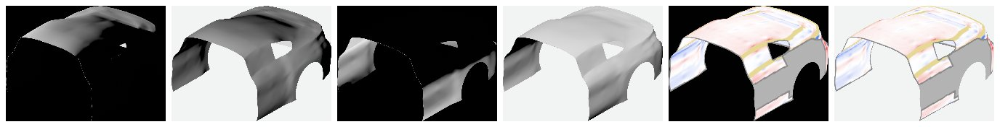
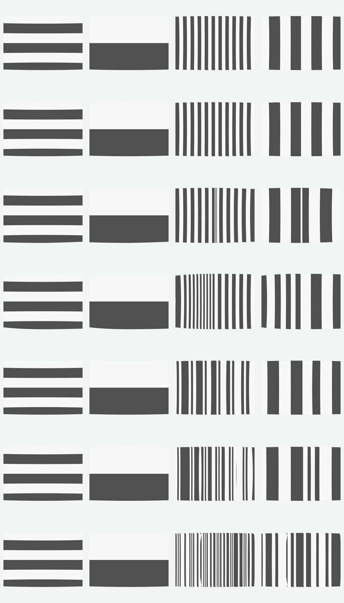
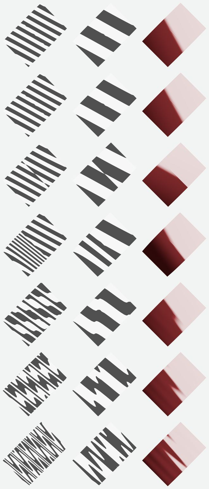
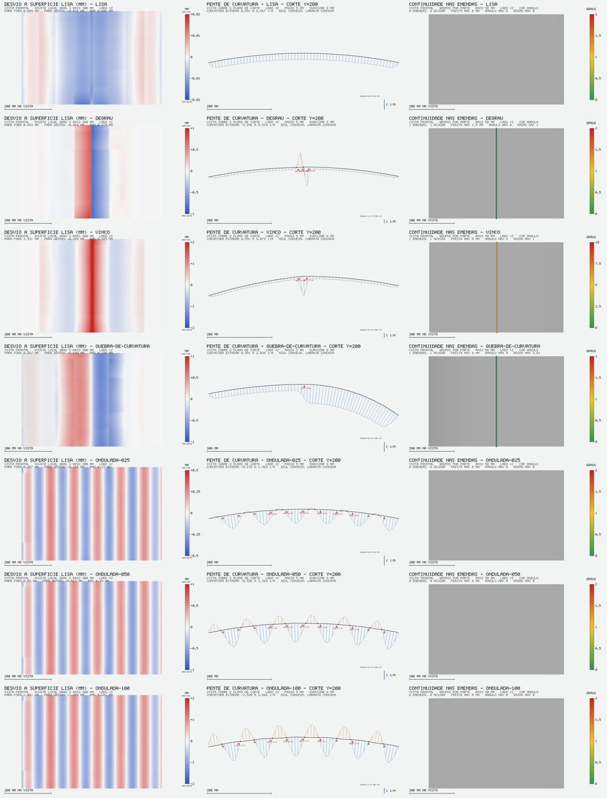

# Reflexo na bancada: a paridade da luz rasante e da curvatura com o Blender

Pasta do plano [reflexo na bancada](../../decisoes/PLANOS-ENCERRADOS.md), fatias 5 e 6, medidas em 2026-11-16. A pergunta é se a luz rasante e a curvatura que a bancada captura por comando (`npm run bancada -- <peça> --visao=luz-rasante|curvatura`) dizem o mesmo que as do Blender 4.2.3 (`tools/modelar/vistas-de-superficie.mjs`), que o pacote do crítico de peça de lataria exigia até a fatia 6. A pessoa decidiu pela medida da fatia 5 deixar de exigir o Blender, e a fatia 6 mediu a vista de três quartos e fez a troca, na última seção.

## Como se mediu

O script [`medir-paridade.mjs`](medir-paridade.mjs) gera as vistas do Blender da peça e, para cada azimute que o Blender escolheu na vista, a luz rasante da bancada com o mesmo azimute, em projeção ortográfica e enquadrada, e a curvatura da bancada na mesma vista. Cada imagem é lida na caixa da peça nela (no Blender, o que não é o fundo preto da curvatura; na bancada, o que não é o fundo da auditoria), e as posições são dadas em fração dessa caixa, de 0 a 1 da esquerda para a direita e de cima para baixo. A fração iluminada segue a regra do Blender (luminância do PNG acima de 8/255 dentro da peça). A posição do amassado é o centroide do 1 % de pixels que mais mudam entre a chapa com amassado e a chapa lisa, na mesma ferramenta. A curvatura que a cor diz sai da cor do pixel, de volta ao linear, pela escala de cada ferramenta; a escala da bancada é a da conta dela (`calculo-da-curvatura.js`), a mesma que a página mostra na legenda. As duas curvaturas são comparadas numa grade de 60 por 40 pontos da caixa, onde as duas têm valor.

As duas peças foram a chapa de prova com amassado (`tools/fixtures/acervo/chapa-de-reflexo-de-prova`, 1000 por 600 mm, amassado de 1,2 mm de fundo e 80 mm de raio em x 400 e y 300, com a lisa como controle), na vista de frente, e o quarto traseiro do carro (`carro-fastback/lataria`, rodada 1), na vista de lado, de +x. Os números estão em [`paridade-chapa.json`](paridade-chapa.json) e [`paridade-quarto-traseiro.json`](paridade-quarto-traseiro.json), e cada um se refaz com:

```
MODELAR_BLENDER=<blender 4.2.3> node docs/modelar/banco-de-provas/reflexo-na-bancada-2026-11-15/medir-paridade.mjs chapa-de-reflexo-de-prova --vista-blender=frente --vista-bancada=frontal --rotulo=chapa --lisa=chapa-lisa-de-reflexo-de-prova --amassado=0.4,0.5 --figura=tmp/paridade-chapa.png
MODELAR_BLENDER=<blender 4.2.3> node docs/modelar/banco-de-provas/reflexo-na-bancada-2026-11-15/medir-paridade.mjs carro-fastback/lataria --vista-blender=lado --vista-bancada=direita --rotulo=quarto-traseiro --figura=tmp/paridade-quarto-traseiro.png
```

A chapa leva perto de 3 minutos e o quarto traseiro perto de 7, quase todo no Blender. As figuras desta pasta são as do `--figura`, reduzidas a JPEG.

## A chapa com amassado

Na figura, da esquerda para a direita: a luz rasante do Blender e a da bancada com a luz a 30 graus, as duas a 120 graus, e a curvatura do Blender e a da bancada.



| medida | Blender | bancada |
| --- | --- | --- |
| fração iluminada, luz a 30 graus | 1,000 | 1,000 |
| fração iluminada, luz a 120 graus | 1,000 | 1,000 |
| amassado na luz rasante a 30 graus (u, v) | 0,4000; 0,5000 | 0,3997; 0,5008 |
| amassado na luz rasante a 120 graus (u, v) | 0,4001; 0,5035 | 0,3992; 0,4995 |
| maior mudança de luminância no amassado, 30 e 120 graus | 0,0235 e 0,0275 | 0,0235 e 0,0275 |
| amassado na curvatura (u, v) | 0,3998; 0,4994 | 0,3996; 0,4994 |
| escala da cor da curvatura | 0,24703 1/m | 0,24758 1/m |
| curvatura que a cor diz no centro do amassado | −0,2465 1/m | −0,2475 1/m |

O amassado declarado fica em u 0,4 e v 0,5, e as duas ferramentas o põem a até 0,001 da caixa em u (1 mm) e a até 0,004 em v (2,4 mm). A luminância das duas luzes rasantes tem correlação de 0,999 e 0,998 na grade, com média de 0,482 contra 0,481 e de 0,485 contra 0,483. A curvatura das duas tem correlação de 0,997 e diferença mediana de 0,003 1/m, 1 % da escala; no centro do amassado as duas saturam a cor, e o valor dali diz só que as escalas batem.

## O quarto traseiro do carro

A mesma ordem: a luz rasante a 230 graus e a 320 graus, que o Blender escolheu para a vista de lado, e a curvatura.



| medida | Blender | bancada |
| --- | --- | --- |
| fração iluminada, luz a 230 graus | 0,909 | 0,908 |
| fração iluminada, luz a 320 graus | 0,785 | 0,805 |
| luminância média da peça, 230 e 320 graus | 0,638 e 0,501 | 0,533 e 0,447 |
| correlação da luminância na grade, 230 e 320 graus | 0,981 e 0,952 | |
| escala da cor da curvatura | 3,77573 1/m | 3,77574 1/m |
| correlação da curvatura na grade | 0,984 | |
| diferença da curvatura na grade, mediana e percentil 90 | 0,047 e 0,237 1/m | |

A carroceria não tem amassado declarado, e a posição de um defeito não se mede nela; o que se mede é que as duas imagens mostram as mesmas manchas no mesmo lugar, pela correlação. A bancada sai mais escura em média, 16 % a 230 graus e 11 % a 320, porque ela reduz a força da luz quando a peça passa de 0,7 de brilho no percentil 99 (`exposicaoDaLuz`, de `src/bancada/visoes/visao-luz-rasante.js`), e o Blender não reduz: na mesma figura, o painel de trás do Blender a 230 graus chega perto do branco e o da bancada não. A diferença da curvatura passa de 0,24 1/m, 6 % da escala, só num décimo dos pontos da grade; onde eles ficam não foi medido.

## O que não foi medido na fatia 5

A vista de três quartos não entrou na fatia 5: a do Blender olha de (0,55; 0,45; 0,70), e a isométrica da bancada olha de (1; 0,72; 1), de modo que as duas não eram a mesma imagem. Ela foi medida na fatia 6, na seção abaixo. Ficou fora a vista de cima, e só duas peças foram medidas.

## Recomendação

Deixar de exigir o Blender no pacote de lataria, trocando a luz rasante e a curvatura dele pelas da bancada, numa fatia própria que faça três coisas antes de tirar a exigência: o `vistas:critica` capturar a luz rasante e a curvatura pela bancada nas vistas de frente e de lado, com a fração iluminada medida em cada imagem e a recusa abaixo de 25 % que o Blender tem hoje; o `pacote.json` e o registro da rodada (`superficieDoPacote`) aceitarem essas imagens; e a vista de três quartos medida antes de entrar. A razão é que, nas duas peças, as duas ferramentas dizem o mesmo: a mesma fração iluminada a 2 pontos, o amassado no mesmo lugar a até 2,4 mm e com o mesmo contraste, a mesma escala de cor a 0,2 % e o mesmo mapa de curvatura, com correlação de 0,98 ou mais. A única diferença medida é o brilho mais baixo da bancada no carro, que é a correção de exposição dela e não muda onde as manchas estão. Enquanto essa fatia não vier, o pacote segue como está: a zebra e a pintura da bancada ao lado das vistas do Blender, que seguem exigidas.

## O crítico cego na chapa de prova (2026-11-16)

O pacote de `npm run vistas:critica -- chapa-de-reflexo-de-prova`, com o PLANO dizendo "chapa lisa" e sem citar o amassado, foi a um crítico visual sem contexto. Ele deu nota 5 e achou um defeito só: um afundamento circular de 100 a 180 mm, uns 100 mm à esquerda do centro em x e no meio em y, que é o amassado declarado (0,4 da largura e 0,5 da altura, 80 mm de raio). Ele o viu na curvatura (o achado mais claro), na zebra frontal (a listra escura partida por um disco de polaridade invertida), na pintura frontal (um disco pálido dentro da faixa escura) e na luz rasante de frente; nas vistas de Modelo, só como mancha muito sutil. O gate do pacote passa: a zebra e a pintura, sozinhas, já mostram o amassado.

Dois atritos saíram do veredito. A imagem de curvatura de lado veio com uns 76 px de largura, com o título e a legenda cortados, porque a chapa vista de quina é estreita (a regra de quina das visões novas não vale para as do Blender). E o vocabulário de `sentido` do veredito não tem termo para afundamento localizado num painel liso, e o crítico escolheu `segmentado` por falta de outro. Os dois foram ao backlog.

## A vista de três quartos e o pacote sem o Blender (fatia 6, 2026-11-16)

A bancada ganhou a vista `tresquartos` (`npm run bancada -- <peça> --vistas=tresquartos --enquadrar`), que gira a câmera da isométrica até olhar de (0,55; 0,45; 0,70), com +y para cima, como a do Blender. A afirmação da fatia 5 de que a do Blender mostra só a metade de x positivo vale para o pacote cego, que passa a simetria; as vistas de superfície não a passam, e as duas ferramentas mostram a peça inteira. A silhueta confere: a caixa da chapa na imagem tem proporção 0,968 no Blender e 0,967 na bancada, e a conta da caixa plana dá 0,966 para a direção do Blender e 0,827 para a isométrica. A medida é a do mesmo script, com `--vista-blender=tresquartos --vista-bancada=tresquartos`; o Blender roda só a vista medida, e `--luz-da-bancada` usa na bancada as duas direções que o pacote usa (a que ela escolhe pela vista e a outra boa a 90 graus dela) no lugar dos azimutes do Blender:

```
MODELAR_BLENDER=<blender 4.2.3> node docs/modelar/banco-de-provas/reflexo-na-bancada-2026-11-15/medir-paridade.mjs chapa-de-reflexo-de-prova --vista-blender=tresquartos --vista-bancada=tresquartos --rotulo=chapa-tresquartos --lisa=chapa-lisa-de-reflexo-de-prova [--luz-da-bancada]
MODELAR_BLENDER=<blender 4.2.3> node docs/modelar/banco-de-provas/reflexo-na-bancada-2026-11-15/medir-paridade.mjs carro-fastback/lataria --vista-blender=tresquartos --vista-bancada=tresquartos --rotulo=quarto-traseiro-tresquartos [--luz-da-bancada]
```

A chapa leva perto de 2 minutos e 40 segundos, e o quarto traseiro perto de 6. Os números estão nos quatro `paridade-*-tresquartos*.json` desta pasta.


| chapa com amassado, três quartos | Blender | bancada |
| --- | --- | --- |
| direções da luz (azimute e altura sobre o plano da imagem) | 30 e 120 graus, a 10 graus | 240 e 150 graus, a 50 graus |
| fração iluminada | 0,999 e 0,999 | 1,000 e 1,000 |
| amassado na luz rasante (u, v) | 0,3844; 0,4746 e 0,3840; 0,4756 | 0,3818; 0,4713 e 0,3820; 0,4739 |
| maior mudança de luminância no amassado | 0,0078 e 0,0353 | 0,0314 e 0,0196 |
| amassado na curvatura (u, v) | 0,3839; 0,4744 | 0,3839; 0,4741 |
| escala da cor da curvatura | 0,24703 1/m | 0,24758 1/m |
| curvatura na grade: correlação, diferença mediana e percentil 90 | 0,995; 0,003 e 0,005 1/m | |

A bancada sobe a luz a 50 graus nessa vista, porque a chapa se inclina 45 graus para longe do plano da imagem, e o Blender fica nos 10 graus. Por isso a luz rasante não se compara pela luminância, e sim pela fração iluminada e pela posição do amassado, que ficam a até 0,004 da caixa. Com os azimutes do Blender e a altura da bancada a medida mostrou o risco de misturar as duas: a 30 graus de azimute e 50 de altura a luz chega quase de frente à chapa, e a imagem da chapa amassada saiu igual à da lisa, pixel a pixel (`paridade-chapa-tresquartos.json`). É por isso que a segunda direção da bancada não é a do Blender: a visão de luz rasante escolhe, na mesma altura, a direção a 90 graus da primeira com a maior legibilidade (`segundaLuz`, em `src/bancada/visoes/azimute-da-luz.js`), e a publica na caixa da visão, de onde a captura a lê.



| quarto traseiro, três quartos | Blender | bancada |
| --- | --- | --- |
| fração iluminada com as direções do Blender (350 e 80 graus) | 0,327 e 0,347, a 10 graus | 0,900 e 0,686, a 60 graus |
| fração iluminada com as direções da bancada (10 e 280 graus) | | 0,929 e 0,975, a 60 graus |
| escala da cor da curvatura | 3,77573 1/m | 3,77574 1/m |
| curvatura na grade: correlação, diferença mediana e percentil 90 | 0,954; 0,047 e 0,197 1/m | |

No carro, a luz de 10 graus do Blender deixa dois terços da peça no escuro nessa vista, e as duas imagens dele mal passam do limiar de 25 %; a da bancada ilumina de 69 a 98 %. A curvatura tem a mesma escala, e a correlação de 0,954 é menor que a de 0,984 da vista de lado; a diferença passa de 0,2 1/m, 5 % da escala, só num décimo dos pontos da grade. A vista de três quartos entrou no pacote: a curvatura diz o mesmo que a do Blender, o amassado sai no mesmo lugar, e a luz da bancada alcança mais da peça que a do Blender.

O que mudou no pacote: `npm run vistas:critica` captura a luz rasante e a curvatura pela bancada nas vistas de frente, de lado, de cima e de três quartos, com a fração iluminada medida em cada PNG pela regra do Blender e a curvatura com a escala e a barra de cor escritas em cima da imagem; a vista em que a peça ocupa menos de 20 % do quadro num dos lados sai também destas, como já saía da zebra e da pintura, o que resolve o primeiro atrito do crítico cego (a curvatura de lado da chapa com 76 px de largura); a imagem abaixo de 25 % sai do pedido com a vista, o azimute, a altura da luz e a fração, e sem nenhuma acima o pacote é recusado; `MODELAR_BLENDER` deixou de ser exigido, e `--com-blender` roda as vistas do Blender como conferência, em `conferencia-do-blender/` da pasta da rodada, fora do pedido. O mesmo vale para `npm run vistas:superficie`. Na chapa de prova, sem `MODELAR_BLENDER`, o pacote levou 1 minuto e 54 segundos, contra 2 minutos e 48 com o Blender; o pedido lista 21 imagens, todas existentes, contra 27 antes, e as 6 a menos são a luz rasante e a curvatura de lado e de cima, de quina. O pedido não cita o amassado da chapa; a palavra aparece só na frase geral da seção de superfície ("o amassado largo e raso"), a mesma que o pedido do crítico cego já tinha.

## O estudo de leitura (fatia 7, 2026-11-16)

A pergunta é o que cada defeito faz com a faixa refletida, medido na imagem, para escrever a instrução de leitura e prová-la num crítico cego. As chapas são as de calibração (`tools/fixtures/reflexo-calibracao/chapas.mjs`): 600 por 400 mm, abauladas em arco de 1,5 m, cada uma numa malha só, com degrau de 1,5 mm, vinco de 6 graus ou quebra de curvatura de razão 3 na linha do meio (duas partes sobre a malha soldada, e o degrau com a parede do desnível como terceira parte), ou ondulação de 100 mm de onda com 0,25, 0,5 e 1 mm na chapa inteira, e a lisa como controle. O script [`estudo-de-leitura.mjs`](estudo-de-leitura.mjs) captura a zebra com listras de 3 e de 9 graus, deitada e, na chapa sem giro, também em pé (`--angulo-da-zebra=90`), a pintura e uma cor por parte (que dá onde fica a linha do defeito na imagem; a lisa e as onduladas a tomam da mesma malha separada em duas partes) nas vistas frontal, isometrica e tresquartos, enquadradas, com a chapa como está e girada 45 graus no próprio plano (`giroGraus`), e mede cada imagem contra a da lisa na mesma vista: a fração da imagem que muda, a direção das listras de cada lado da linha e a dobra entre elas, o espaçamento das listras de cada lado, o deslocamento de cada borda de listra em relação à borda da lisa, procurada ao longo da normal das listras da lisa até meio período, e, sem comparar com a lisa, a borda torta colada à linha (a fração das bordas de listra a até 6 px da linha cuja direção se afasta mais de 15 graus da das bordas em volta). Os números estão em [`estudo-de-leitura.json`](estudo-de-leitura.json) e [`estudo-de-leitura-ferramentas.json`](estudo-de-leitura-ferramentas.json), e se refazem com `node docs/modelar/banco-de-provas/reflexo-na-bancada-2026-11-15/estudo-de-leitura.mjs` (perto de 25 minutos, quase todo de captura) e `--ferramentas` (30 segundos).

As chapas foram refeitas depois da primeira rodada da prova cega (seção seguinte). Até ali cada uma era de duas folhas não soldadas, e a borda livre de cada folha fazia um dente na faixa colado à linha do meio, também na lisa. A borda torta mede esse dente: na lisa velha girada, 0,40 e 0,45 das bordas a até 6 px da linha na zebra de 3 e de 9 graus, na isométrica, 0,32 e 0,20 de três quartos, e 0,22 na pintura isométrica; nas faixas paralelas a 60 e a 120 px, zero. Na lisa nova é zero em toda vista e largura, e a pintura não tem borda nenhuma perto da linha. Comparadas pixel a pixel, a lisa velha e a nova diferem em 1 a 8 de 10 mil pixels na zebra e em nenhum na pintura: o dente era pequeno na imagem e grande na leitura.

A primeira medida mudou o estudo. A zebra da bancada pinta a listra deitada pelo componente vertical do olhar refletido (`visao-zebra.js`), e nas chapas como estão a linha do defeito e a onda correm em pé, de modo que a normal só inclina para os lados. Ali a listra deitada não andou: de frente, com a de 9 graus, mudou 0,008 da imagem no vinco, 0,011 na quebra e no máximo 0,0002 nas onduladas. A listra em pé vê tudo isso, e é por isso que a zebra ganhou o ângulo da listra:

| chapa sem giro, de frente | muda contra a lisa, deitada, 9 e 3 graus | muda contra a lisa, em pé, 9 e 3 graus | o que a faixa em pé faz |
| --- | --- | --- | --- |
| lisa | 0 | 0 | corre reta |
| degrau 1,5 mm | 0,0002 e 0,0002 | 0,0003 e 0,0003 | igual à lisa de frente; nas oblíquas, o traço fino da parede (0,47 a 0,50 dos pixels da linha fora do tom dos vizinhos) |
| vinco 6 graus | 0,008 e 0,018 | 0,43 e 0,32 | parte na linha, deslocada 0,48 do período com a de 9 graus |
| quebra de curvatura, razão 3 | 0,011 e 0,024 | 0,29 e 0,27 | o espaçamento 2,1 vezes mais apertado do lado de raio 0,5 m, com a de 3 graus |
| ondulada 0,25, 0,5 e 1 mm | 0 a 0,0002 | 0,10, 0,22 e 0,44 com a de 9 graus | serpenteia e dobra, como a deitada na chapa girada |

Nas vistas oblíquas a perspectiva já leva parte da inclinação para os lados à listra deitada (0,05 a 0,08 da imagem no vinco e 0,12 a 0,15 na quebra), mas a em pé continua mostrando mais. A figura é a vista frontal das chapas sem giro: em cada linha, da lisa à ondulada de 1 mm, a zebra deitada de 3 e de 9 graus e a em pé de 3 e de 9 graus.



A [isométrica das mesmas chapas](estudo-g0-isometrica.jpg), com a zebra deitada e a pintura, mostra o pouco que a deitada vê ali. Girada 45 graus, a linha e as cristas da onda correm na diagonal, e o defeito aparece também na listra deitada. A figura é a vista frontal, com a zebra de 3 e de 9 graus e a pintura.



Na isométrica, na [figura à parte](estudo-g45-isometrica.jpg), a leitura é a mesma, e a pintura já quase não mostra a ondulação.

| chapa girada, zebra deitada | muda contra a lisa, 3 e 9 graus, de frente | dobra da listra na linha (frontal, isometrica, tresquartos) | o que a faixa faz |
| --- | --- | --- | --- |
| lisa | 0 | 0,0; 1,0; 0,7 graus | corre reta, sem linha no meio (borda torta 0) |
| degrau 1,5 mm | 0,0020 e 0,0007 | -0,1; 0,4; 0,2 graus | igual à lisa de frente; nas vistas oblíquas aparece o traço da parede (0,013 a 0,024 da imagem muda, borda torta 0,05 a 0,22 na linha) |
| vinco 6 graus | 0,30 e 0,43 | 0,9; 8,3; 6,5 graus | parte na linha e continua deslocada: 0,44 do período com a listra de 9 graus (123 px) e 0,31 com a de 3 (29 px) |
| quebra de curvatura, razão 3 | 0,28 e 0,21 | -8,8; -10,8; -10,1 graus | não parte; faz cotovelo e o espaçamento é 2,0 a 2,2 vezes mais apertado do lado de raio 0,5 m de frente, 1,7 a 3,8 nas outras vistas |
| ondulada 0,25 mm | 0,24 e 0,08 | | serpenteia; deslocamento de 0,06 do período de 9 graus no percentil 95 |
| ondulada 0,5 mm | 0,47 e 0,16 | | serpenteia e começa a dobrar sobre si; o deslocamento bate no meio período (0,46), e a medida satura |
| ondulada 1 mm | 0,64 e 0,31 | | ziguezague: as listras se multiplicam (o espaçamento cai de 94 para 36 px com a de 3 graus) |

A fração que muda na ondulada, com a listra de 9 graus, é 0,081, 0,159 e 0,314 de frente, 0,057, 0,108 e 0,217 na isométrica e 0,060, 0,118 e 0,232 de três quartos: cresce com a amplitude, quase em proporção, nas três vistas. A pintura girada muda 0,024, 0,049 e 0,088 da imagem de frente na ondulada, 0,0001 a 0,0015 nas outras duas vistas, 0,08 a 0,11 no vinco, 0,03 a 0,16 na quebra e até 0,01 no degrau.

As leituras por número, nas chapas como estão (elas não dependem da direção), estão na figura abaixo, uma linha por chapa: o mapa de desvio, o pente na seção y = 200 mm e a continuidade nas emendas com a cor do ângulo.



| chapa | mapa de desvio (mm, para fora e para dentro) | pente (1/m, a seção inteira) | emendas, raio 50 mm | suavidade (1/m², por parte) |
| --- | --- | --- | --- | --- |
| lisa | +0,004 e -0,016 | 0,59 a 0,67, sem salto | nenhuma emenda | 0,001 |
| degrau | +0,89 e -0,87, na linha | 0,59 a 0,67, e as hastes -4,2 e +5,5 na parede | fresta 1,5 mm em 41 de 41 pontos, ângulo 0 | 0,001 e 0,001 (a parede não tem índice) |
| vinco | +2,93 na linha | 0,59 a 0,67, e a haste de 5,1 na linha | ângulo 6,00 graus em 41 de 41 | 0,001 e 0,001 |
| quebra de curvatura | +0,57 e -0,69 | 2,04 de um lado e 0,59 a 0,67 do outro, um salto na linha | razão 3,007 em 41 de 41, ângulo 0,003 | 0,039 e 0,001 |
| ondulada 0,25 | +0,27 e -0,27 | 11 saltos e 11 trocas de sinal, maior salto 0,94 | nenhuma emenda | 29,3 |
| ondulada 0,5 | +0,54 e -0,56 | idem, maior salto 1,88 | nenhuma emenda | 55,4 |
| ondulada 1 | +1,08 e -1,05 | idem, maior salto 3,77 | nenhuma emenda | 107,0 |

Com as chapas numa malha só, o pente passa a ver a linha do defeito: a seção é uma curva só, e o vinco e o degrau aparecem como hastes na linha, de altura que depende do passo da malha (o ângulo de 6 graus dobrado numa célula de 10 mm), e não como medida do defeito, que sai da continuidade nas emendas. A continuidade acha cada defeito com a medida declarada, e a parede do degrau tem de ser parte à parte: dentro da parte da folha, os vértices dela entravam no ajuste de um lado e davam ângulo de 3,7 graus e razão 4,6 que não existem. As onduladas, sem emenda, não dão mais a quebra de curvatura falsa que a crista de onda perto da emenda dava; a regra do raio menor que a distância à feição mais perto continua a da fatia 4. O mapa de desvio, cujo ajuste atravessa a linha, reparte o degrau entre os dois lados.

O que isso diz da leitura, escrito em [Ler o reflexo](../../usar/PARE-E-ANALISE.md#ler-o-reflexo) e, na versão curta, no pedido do crítico de lataria (`LEITURA_DO_REFLEXO`): a faixa é uma ordem menos contínua que a chapa, e por isso o degrau não aparece na zebra, o vinco a parte e a quebra a dobra; a listra larga mede o salto que a fina engana; cada direção da listra vê o que a outra não vê, e o pedido de lataria leva a zebra deitada e em pé; e a medida em milímetro sai do mapa de desvio, a da emenda sai da continuidade nas emendas com o raio menor que a distância à feição, e a comparação entre rodadas sai do índice de suavidade.

A prova cega usa as chapas giradas 45 graus. O script [`preparar-prova-cega.mjs`](preparar-prova-cega.mjs) gera, para cada chapa, uma receita de nome neutro (`chapa-a` a `chapa-g`, em ordem que não segue a das chapas) com o PLANO dizendo só "chapa abaulada de prova", captura a zebra deitada e em pé e a pintura nas três vistas, como o pacote de lataria as captura (`CAPTURAS_DO_REFLEXO`), copia as imagens com nomes neutros e escreve o pedido com a seção Reflexo do pedido de lataria (`secaoDoReflexo`); o gabarito fica fora das pastas dos pedidos, em `tmp/prova-cega/gabarito.json`.

## A prova cega da leitura, primeira rodada (2026-11-16)

Sete críticos visuais sem contexto receberam cada um uma chapa de calibração girada 45 graus, só com a zebra e a pintura em três vistas e a leitura curta do pedido, sem o nome nem o defeito. Comparado com o gabarito: o vinco (chapa B) e a quebra de curvatura (chapa E) foram achados com o tipo e o lugar certos; a ondulação de 1 mm (chapa D) foi achada, mas junto de um vinco que não existe; a chapa lisa (C) foi lida como quebra de curvatura, o degrau (F) como vinco, e as ondulações de 0,5 e 0,25 mm (A e G) passaram sem ser vistas, lidas como vinco e como quebra de curvatura na linha do meio. Duas de sete certas, uma em parte.

A causa principal é da peça de prova e não da leitura: toda chapa de calibração é feita de duas folhas não soldadas que se encontram na linha do meio, e a normal da borda de cada folha faz um dente na faixa mesmo na chapa lisa; os sete críticos viram essa linha e a leram como defeito, e nas onduladas ela tomou o lugar da onda. O processo não pegaria isso sozinho: o gabarito dizia para não contar o dente da lisa, mas o pedido não tinha como dizer ao crítico. A correção é da fixture (a chapa lisa e as onduladas numa folha só, e as de emenda com as folhas soldadas, sem a borda), e a prova se repete com a leitura curta como está.

## A prova cega da leitura, segunda rodada: os pedidos (2026-11-16)

As chapas foram refeitas numa malha só, como a seção do estudo descreve, e a lisa ficou sem linha nenhuma no meio (borda torta zero em toda vista, na zebra e na pintura). A zebra ganhou o ângulo da listra, e o pedido de lataria passou a levar a zebra deitada e em pé, com a leitura curta dizendo que uma direção vê o que a outra não vê. Os sete pedidos foram refeitos com `preparar-prova-cega.mjs`, com as letras embaralhadas de novo, cada um com nove imagens (a zebra deitada, a em pé e a pintura, nas três vistas); o gabarito está em `tmp/prova-cega/gabarito.json`, fora das pastas dos pedidos. A comparação com o gabarito entra aqui quando os críticos responderem.


## A prova cega da leitura, segunda rodada (2026-11-16)

Com as chapas soldadas e a zebra deitada e em pé, sete críticos novos, letras embaralhadas de novo. Comparado com o gabarito: a lisa (D) foi lida sem defeito; a quebra de curvatura (C) e o vinco (G) foram achados com o tipo e o lugar certos (o do vinco com uma dúvida a mais junto dele). A ondulação de 1 mm (F) foi achada, junto de um amassado e de uma quebra que não existem; a de 0,25 mm (B) foi lida como duas ou três linhas de quebra de curvatura paralelas e uma ondulação larga de fundo. O degrau (A) foi lido como vinco, e a ondulação de 0,5 mm (E) como vinco com amassado. Três de sete certas e duas em parte, contra duas e uma na primeira rodada.

Os dois erros que restam têm forma: a crista de uma onda regular, que faz um cotovelo em cada listra, é lida como linha de quebra ou de vinco quando há poucas cristas no quadro, e a parede do degrau, que faz a listra correr deslocada de um lado para o outro, é lida como vinco. Nenhuma das duas leituras está prevista na leitura curta: ela diz o que a onda faz, mas não que várias linhas paralelas e igualmente espaçadas são uma onda, e diz que o degrau só deixa um traço fino, o que vale para a chapa girada e não para a parede soldada.

## A prova cega da leitura, terceira rodada (2026-11-16)

Com a leitura curta corrigida nos dois pontos da segunda rodada e as letras embaralhadas outra vez. Comparado com o gabarito: a lisa (E) foi lida sem defeito no painel, com uma dúvida de baixa confiança na borda; o degrau (C) foi achado e separado do vinco pela direção da faixa dos dois lados; as três ondulações (G de 0,25 mm, A de 0,5 mm e D de 1 mm) foram lidas como ondulação pelas cristas paralelas, as duas maiores com uma ou duas suspeitas a mais, que o próprio crítico marcou como não confirmadas; a quebra de curvatura (F) foi apontada no lugar e com o tipo certos, mas como candidato fraco, sem dizer que é defeito; e o vinco (B) foi lido como degrau. Cinco de sete certas, uma em parte e uma errada, contra duas, três e cinco nas três rodadas.

O erro que resta é a fronteira entre vinco e degrau: a faixa dá um passo curto nos dois, e no vinco de 6 graus a mudança de direção dos dois lados é pequena demais para o crítico separar na imagem. As ferramentas de medida acharam os sete defeitos com o tipo e o tamanho certos (`emendas`, `suavidade`, `desvio`).
