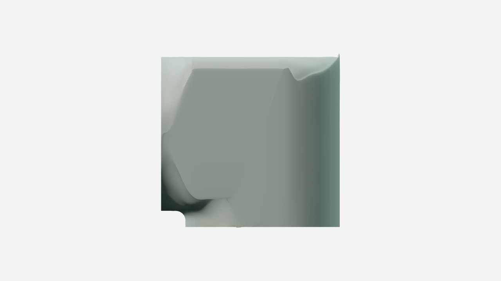
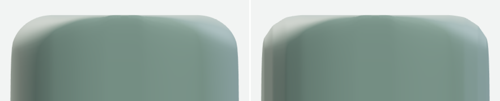
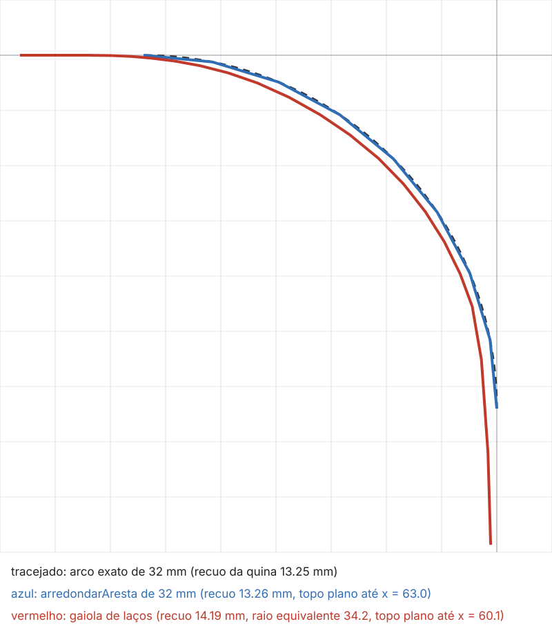
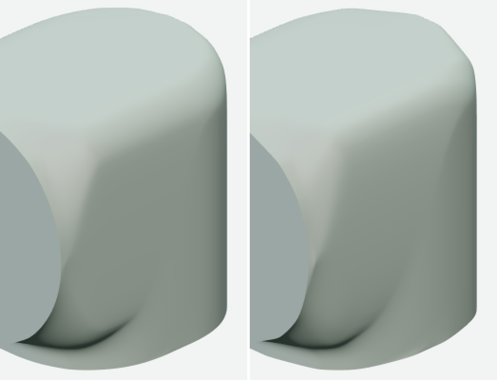

# Sólido por laços — fatia 1, a linha de base

Fatia 1 do plano [sólido por laços](../../planos/2026-11-05-solido-por-lacos.md), em 2026-11-05. A peça de teste é
`tools/fixtures/solido-por-lacos/`: um L de ponta-cabeça de 190 por 220 mm, com a parte de pé recuada 30 mm, quinas de 75 mm em
planta, cantos de 32 mm na seção e saída redonda de 190 mm, fechado numa malha só pela subdivisão de uma gaiola de 21 laços, um
por plano x, cada um com 39 pontos. A gaiola é a do corpo do ombro do braço, transcrita sem citar o braço e separada em três
funções em `forma.js`: `planosDeCorte` e `lacoNoPlano` são da forma, e `gaiolaDosLacos` é a montagem (as tiras entre laços
vizinhos, a escada que tampa as paredes de lado, a ponta da saída nos laços de lado, a orientação e os dois vincos vivos) que o
ajudante vai envolver na fatia 2. O ajudante ainda não existe.

## A peça de teste

| medida | valor |
|---|---:|
| malha | 13.034 vértices, 13.032 faces |
| arestas sem par, vínculos não manifold, triângulos sem área | 0, 0, 0 |
| menor triângulo (piso da peça) | 1,5e-7 m² (6,0e-11 m²) |
| desvio contra o corpo do ombro, nos dois sentidos | 0,000 mm |
| falhas de ondulação acima de 0,3 mm, faces viradas | 5 (a maior 0,81 mm), 0 |

O desvio é a maior distância de um vértice de uma malha à superfície da outra (`desvioEntreMalhas` de `medir.mjs`), contra as
faces da parte `pescoco` do ombro, e dá zero porque a montagem é a mesma: as duas malhas têm os mesmos 26.064 triângulos. As
cinco falhas da ondulação já estão no ombro, com as mesmas amplitudes: 0,81 mm na face de baixo logo depois do encontro, 0,76 mm
no topo junto da borda de trás, 0,58 mm no encontro junto da quina do pé e duas de 0,3 mm na transição para a saída, perto da
parede de lado.


## Os quatro limites

O limite 1 é a cota exata em todos os 817 pontos da gaiola (`medidas: 'todos'`). A ondulação acusa uma emenda de 62,6 mm na
parede de lado, junto da borda de cima (x = ±94,8, y = 188,6, z = −23 mm), e 302 faces viradas; a malha sai a até 6,37 mm da
forma de referência, e o canto da seção fica com 10,65 mm de recuo, mais vivo que o arco pedido. Na imagem, a parede de lado
dobrada.



O limite 2 são os planos de corte a menos de 2,5 mm entre si. A forma de referência tira os que ficam mais perto que isso e fica
com 21 planos, o mais perto a 2,56 mm do vizinho; sem o filtro ficam 27, o mais perto a 0,12 mm. A ondulação acusa uma falha de
5,16 mm no topo da traseira (x = 0, y = 182,9, z = −95 mm), que a referência não tem, e a malha sai a até 1,26 mm da referência.
Na imagem, a traseira de perto, a referência à esquerda e os planos próximos à direita, com as quinas de cima quebradas.



O limite 3 é a aresta mais macia que a do `arredondarAresta`. No corte z = 0, o canto de cima da seção, desenhado com os pontos da
gaiola num arco de 32 mm, fica a 14,19 mm da quina viva ao longo da bissetriz, que é o recuo de um arco de 34,2 mm, e o topo é
plano só até x = 60,1 mm. A caixa de `aresta-arredondada.js`, da mesma seção com `arredondarAresta` de 32 mm, dá 13,26 mm de
recuo, 32,0 mm de raio equivalente e topo plano até x = 63,0, que são os números do arco exato. Na imagem, os três cortes.



O limite 4 é o calombo onde há poucos pontos. Na forma de referência, a maior razão entre dois trechos vizinhos do laço do meio é
20, na borda de cima da traseira, onde o trecho da parede tem 52,5 mm e o primeiro do topo 2,6 mm; é ali o calombo de 0,76 mm.
Com metade dos planos por quarto de quina em planta (17 planos), o calombo junto do encontro sobe de 0,58 a 1,27 mm, o da
traseira de 0,76 a 1,00 mm, e a malha sai a até 3,16 mm da referência. Com 4 pontos no topo em vez de 7, a falha do topo vira uma
ondulação de 2,78 mm, e a malha sai a até 13,0 mm. Na imagem, a referência à esquerda e a quina com poucos planos à direita, com
as quinas em planta facetadas e o calombo no encontro.



## Notas

A escada que tampa as paredes de lado liga o ponto j da cadeia de cima ao ponto j da cadeia de baixo, e por isso as duas
precisam ter o mesmo número de pontos: para tirar 3 pontos do topo foi preciso tirar 3 da face de baixo, e o teste confere que
`forma.js` recusa as cadeias desiguais. A ondulação acusa 22,4 mm de ondulação junto da borda da saída, na parede de lado
(x = ±94,9, y = 115, z = 64,6 mm), na referência e no ombro, e 25,5 mm com os planos próximos, mas nessa região a parede fica
entre x = 94,20 e 94,92 mm: o número é da leitura, que ajusta a superfície com vizinhança de três espaçamentos de 73,6 mm e
contorna as quinas da parede, e não da forma. É esse o número de 25 mm do backlog; o defeito dos planos próximos é a falha de
5,16 mm na traseira.

## Como reproduzir

```text
npx vitest run tools/fixtures/solido-por-lacos
node tools/fixtures/solido-por-lacos/medir-limites.mjs
npm run malha:conferir -- tools/fixtures/solido-por-lacos
npm run ondulacao -- tools/fixtures/solido-por-lacos
node tools/fixtures/solido-por-lacos/desenhar-canto.mjs limite-3-canto-da-secao.png
npm run bancada -- tools/fixtures/solido-por-lacos --vistas=isometrica --res=1600
npm run bancada -- tools/fixtures/solido-por-lacos --analise
npm run bancada -- tools/fixtures/solido-por-lacos/variantes/medidas-em-todos.js --analise
npm run bancada -- tools/fixtures/solido-por-lacos/variantes/planos-proximos.js --analise --zoom=traseira:420,110,860,290 --zoom-antes=<traseira da referência>
npm run bancada -- tools/fixtures/solido-por-lacos/variantes/poucos-planos-na-quina.js --analise --zoom=isometrica:560,160,820,560 --zoom-antes=<isométrica da referência>
```

O teste, em uns 12 s, confere o fechamento, o desvio contra o ombro, a repetição da malha, o canto contra o `arredondarAresta`,
as distâncias entre planos, a razão de amostragem e o desvio da cota em todos os pontos, e imprime os números. `medir-limites.mjs`
leva perto de 80 s e imprime em JSON a ondulação da referência e das quatro variantes de `variantes/variantes.js`. A imagem do
limite 1 é a vista `direita-orto` da análise, e as dos limites 2 e 4 são o `zoom-*-antes-depois.png` da análise, com a vista da
referência como antes.
