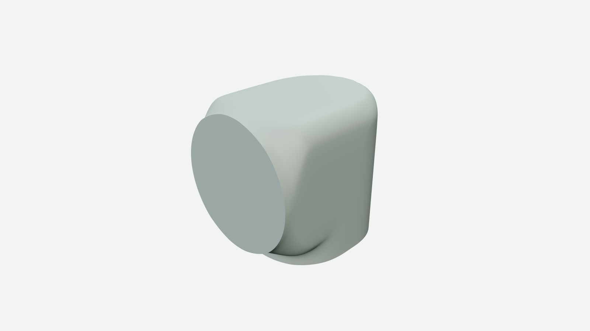
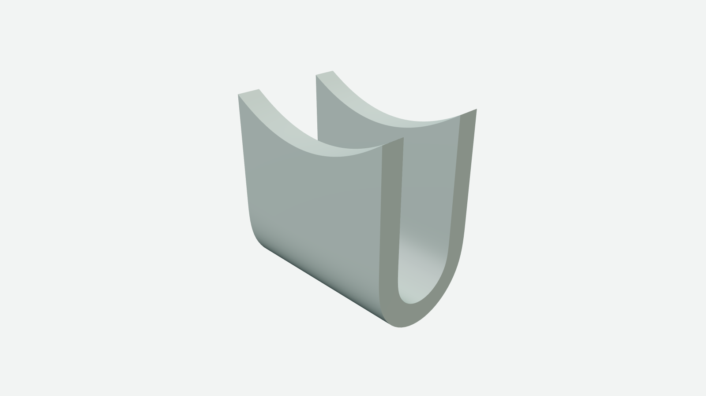
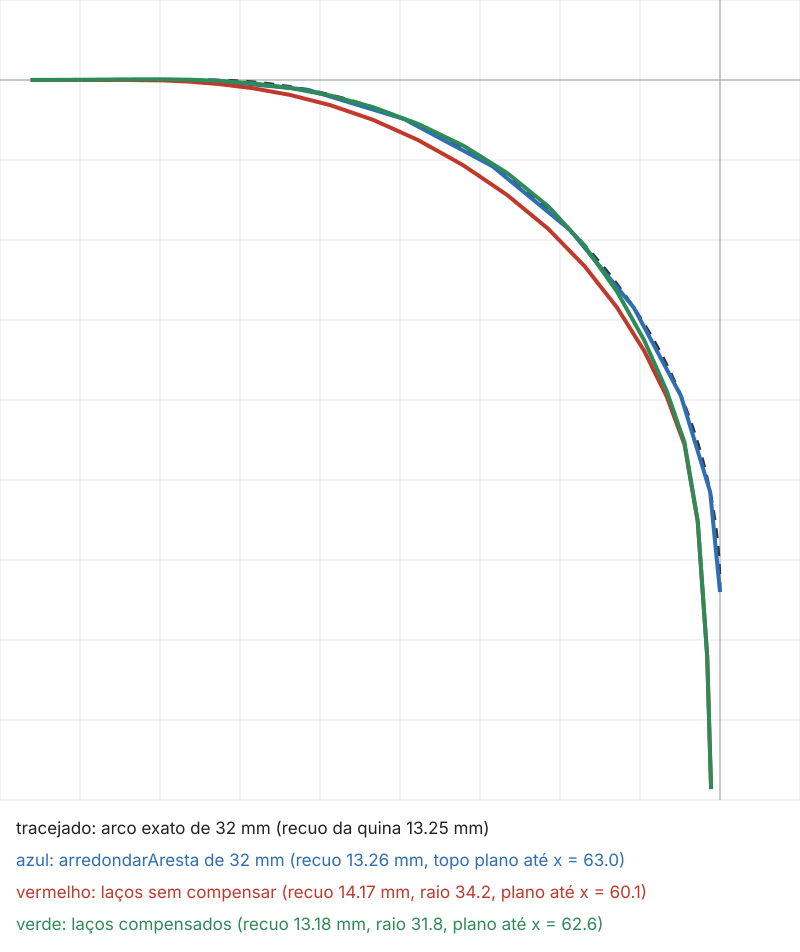

# Sólido por laços — provas das fatias 1 a 3

Provas do plano [sólido por laços](../../decisoes/PLANOS-ENCERRADOS.md), em 2026-11-05. O ajudante é `gaiolaPorLacos`, em
`procedural/nucleo/gaiola-por-lacos.js`, e as peças de teste ficam em `tools/fixtures/solido-por-lacos/`: o L de ponta-cabeça de
190 por 220 mm (`receita.js`, com a forma em `forma.js`), que refaz o corpo do ombro do braço sem citá-lo, e a dobra em U
(`dobra-em-u.js`). A receita dá, em cada plano x, o contorno da peça em trechos nomeados, cada um uma polilinha; o ajudante
reamostra cada trecho com pontos por igual no número que a receita pede, liga os laços vizinhos, tampa as duas pontas com uma escada
entre as duas cadeias de `tampa.de` a `tampa.ate`, funde os pontos seguidos que coincidem e orienta as faces pelo sinal do volume.

## A peça em L pelo ajudante (fatia 2)

O L tem 21 laços de 39 pontos, em doze trechos: `tras`, cinco trechos do topo (`borda`, `quina`, `topoDeTras`, `topoDoMeio` e
`topo`, que acabam em 1,5 %, 5 %, 12 %, 45 % e 100 % do topo e dão os pontos mais perto junto da parede de trás), `transicao`,
`saida`, `baixo`, `encontro`, `frente` e `fundo`. A tampa é a escada do `fundo` à `saida`, com 18 pontos de cada lado, e nos dois
planos de lado a `saida` tem comprimento zero e se funde numa ponta. Os vincos vivos são `{ trecho: 'fundo' }` e
`{ trecho: 'saida' }`, as bordas das faixas desses trechos.

| medida | valor |
|---|---:|
| malha | 13.034 vértices, 13.032 faces |
| arestas sem par, vínculos não manifold, triângulos sem área | 0, 0, 0 |
| desvio da forma contra o corpo do ombro, nos dois sentidos | 0,431 mm |
| falhas de ondulação acima de 0,3 mm, a maior, faces viradas | 3, 0,807 mm, 0 |
| as mesmas, no corpo do ombro | 5, 0,811 mm, 0 |

O desvio é a maior distância de um vértice de uma malha à superfície da outra (`desvioEntreMalhas` de `medir.mjs`), contra as
faces da parte `pescoco` do ombro, e fica no começo da transição para a saída, junto da parede de lado (x = ±86, y = 196, z = 84 mm),
onde o ajudante põe os pontos da transição por igual no comprimento e o ombro os punha por igual em z. A ondulação fica à parte,
como a pessoa decidiu em 2026-11-05: o L tem três falhas contra cinco do ombro, e a maior é 0,807 contra 0,811 mm. Lugar a lugar,
o calombo da borda de cima da parede de trás vai de 0,76 a 0,807 mm, o do encontro junto da quina do pé de 0,58 a 0,693, o da face
de baixo antes da saída cai de 0,811 a 0,678, e as duas falhas de 0,3 mm perto da parede de lado somem. A malha sai igual a cada
execução, e o passo da gaiola também.



A primeira divisão do topo, em três trechos (`quina` até 5 %, `topoDeTras` até 25 % e `topo`), ficou a 0,84 mm do ombro na borda de
trás; com o topo de 25 % a 100 % em um trecho de quatro pontos, a ondulação acusava um calombo de 1,84 mm no topo plano (x = 43,9,
z = −35,5), onde a malha fica entre y = 209,89 e 210,00 mm, o que é leitura da ferramenta, que ajusta a superfície com vizinhança
de três espaçamentos e alcança as quinas quando o espaçamento cresce. A divisão em cinco trechos acompanha o espaçamento do ombro e
tira as duas coisas.

## A dobra em U

A dobra tem 120 mm de largura, 13 laços a cada 10 mm e oito trechos: as duas pontas dos braços, os braços de fora e de dentro e as
duas curvas, de 40 e 24 mm de raio em volta do mesmo centro. A tampa é a escada de uma ponta à outra, entre a cadeia de fora e a de
dentro, e os vincos vivos são as voltas do primeiro e do último laço (`{ laco: 'primeiro' }` e `{ laco: 'ultimo' }`) e as quatro
linhas das bordas das pontas (`{ entre: [...] }`). A ponta sobe em sela de 70 mm no meio a 90 mm nos lados.

| medida | sem compensar | compensada |
|---|---:|---:|
| malha | 7.874 vértices, 7.872 faces | a mesma |
| arestas sem par, vínculos não manifold, triângulos sem área | 0, 0, 0 | 0, 0, 0 |
| raio da curva de fora no corte x = 0, pedido 40 | 39,05 mm | 40,05 a 40,10 mm |
| raio da curva de dentro no corte x = 0, pedido 24 | 23,43 mm | 24,03 a 24,06 mm |
| falhas de ondulação, faces viradas, avisos | 0, 0, nenhum | 0, 0, nenhum |

O raio é a distância ao centro da dobra dos pontos do corte a até 60 graus do fundo (`raioDaDobra` de `medir.mjs`).



## Os quatro limites do ombro (fatia 3)

O limite 1, a cota exata em todos os pontos, é recusado: `medidas: 'todos'`, ou marcas que cobrem todos os pontos, saem com
"medidas em todos os pontos não é aceito: na peça de teste do plano do sólido por laços, a cota exata nos 817 pontos da gaiola
dobrou a parede de lado numa emenda de 62,6 mm e virou 302 faces; marque só os pontos de cota, por trecho, por entre ou por laço".
A cota marcada por trecho, por ponto entre dois trechos ou por laço passa ao passo, com peso quando vem.

O limite 2, os planos a menos de 2,5 mm, é recusado com o par mais perto e a distância. Sem o filtro da forma, o L fica com 27
planos, e o ajudante diz "os laços 'l1' (x = −92,56 mm) e 'l2' (x = −92,44 mm) ficam a 0,12 mm um do outro, abaixo do mínimo de
2,5 mm, e mais 7 pares ficam abaixo do mínimo". O L de referência tem o par mais perto a 2,556 mm.

O limite 3, o canto mais macio que o do `arredondarAresta`, tem a compensação: `compensar: { trechos, lacos? }` move os pontos
marcados no plano do laço, pela normal da gaiola sem a componente do eixo, até o ponto limite da subdivisão chegar ao ponto
declarado, em oito passos. No L, com os trechos do topo e da transição compensados nos laços dos cantos (|x| a partir de 63 mm), o
canto de 32 mm sai com 31,8 mm no corte z = 0 (recuo de 13,18 mm contra 13,26 do arco exato), onde sem compensar saía com 34,2; 90 dos
138 pontos marcados andam, até 3,8 mm, e o resíduo no ponto limite fica em 0,013 mm (na dobra, 216 pontos, até 1,2 mm). A forma compensada sai a até 1,81 mm do ombro, no começo
da transição junto da parede de lado, porque o ombro tem o canto mais macio, e a ondulação tem sete falhas, a maior de 0,821 mm,
sem face virada. Os pontos de normal quase no eixo, como os do plano de lado, não andam, e por isso a parede de lado continua a
93,6 mm do centro no corte, como no ombro (93,7). Na imagem, o corte do canto.



O limite 4, o calombo da amostragem desigual, é o aviso: onde o último segmento de um trecho e o primeiro do seguinte têm razão
acima de 4, fora de vinco e de canto, e onde dois intervalos vizinhos entre planos têm razão acima de 4, o ajudante avisa com os
trechos (ou os planos), o laço da maior razão e a razão. O L de referência avisa duas junções, que são as do ombro: da `tras` à
`borda` (razão 29,7, no plano de lado), onde fica o calombo de 0,807 mm, e do `topo` à `transicao` (6,4). Com metade dos planos na
quina em planta, saem também quatro avisos de planos desiguais (razões de 5,6 e 6,8), e a ondulação sobe a 1,106 mm. Com o topo
num trecho só de cinco pontos o aviso não sai, porque o espaçamento não salta; a forma sai a até 11,7 mm do L e a ondulação acusa
2,66 mm, e o que pega esse caso é a ondulação, não o aviso.

## A fatia 1, linha de base

A fatia 1 transcreveu a gaiola do ombro numa peça neutra, a 0,000 mm do ombro, e reproduziu os quatro limites com número: a cota
exata em todos os pontos dava uma emenda de 62,6 mm e 302 faces viradas, os planos a 0,12 mm uma falha de 5,16 mm na traseira, o
canto de 32 mm saía com o recuo de um arco de 34,2 mm, e metade dos planos na quina levava o calombo do encontro de 0,58 a
1,27 mm. As imagens dessa linha de base ficam nesta pasta (`limite-1-medidas-em-todos.png`, `limite-2-planos-proximos.png`,
`limite-3-canto-da-secao.png`, `limite-4-poucos-planos-na-quina.png`); foram feitas com a transcrição, que a fatia 2 trocou pelo
ajudante, e se refazem a partir do commit 38ac88c7.

## Notas

O comando `npm run capacidade -- gaiolaPorLacos` ainda não acha a ficha, porque a lista de capacidades fica escrita em
`tools/modelar/capacidade.mjs`, que é do plano da porta de entrada; a ficha está no cabeçalho do ajudante, com 22 linhas, e o
teste do ajudante a confere pelo mesmo `lerFicha` (partes, limite de 60 linhas, campos no código e exemplo que o passo aceita).

## Como reproduzir

```text
npx vitest run procedural/nucleo/gaiola-por-lacos.test.ts tools/fixtures/solido-por-lacos
node tools/fixtures/solido-por-lacos/medir-limites.mjs
node tools/fixtures/solido-por-lacos/desenhar-canto.mjs canto-da-secao-compensado.png
npm run bancada -- tools/fixtures/solido-por-lacos --vistas=isometrica --res=1600
npm run bancada -- tools/fixtures/solido-por-lacos/dobra-em-u.js --vistas=isometrica --res=1600
npm run bancada -- tools/fixtures/solido-por-lacos/variantes/compensada.js --vistas=isometrica --res=1600
```

O teste da peça, em uns 25 s (20 s na ondulação do L e do ombro), confere o fechamento das duas peças, o desvio e a ondulação
contra o ombro, a repetição, as duas recusas, o canto e as curvas compensados e os avisos, e imprime os números.
`medir-limites.mjs` leva perto de 90 s e imprime em JSON a ondulação, o desvio, o canto, os avisos e as recusas de todas as
variantes de `variantes/variantes.js` e da dobra.
